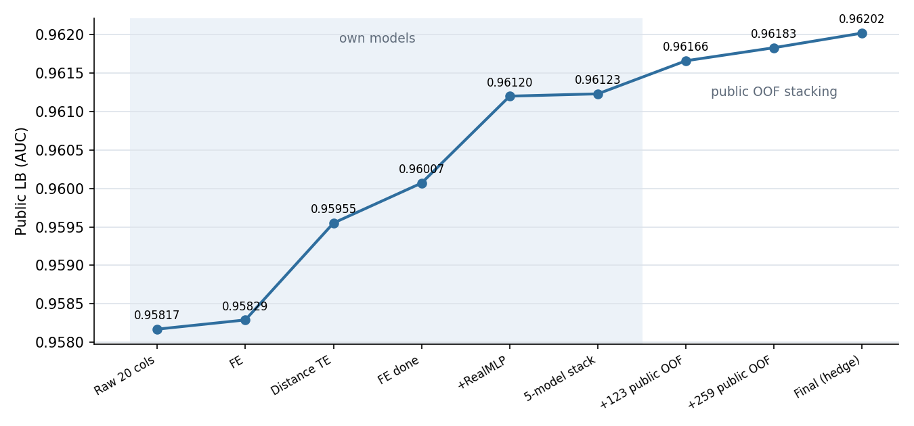
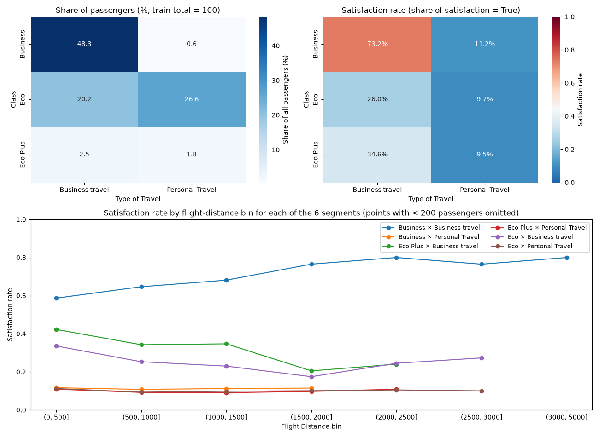
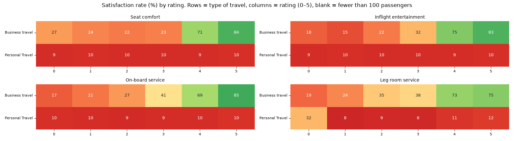
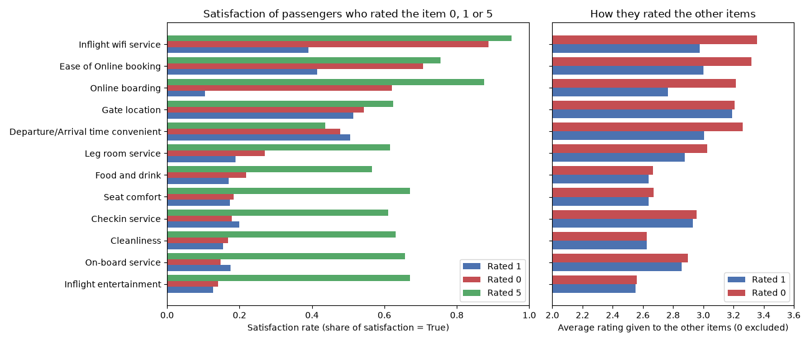
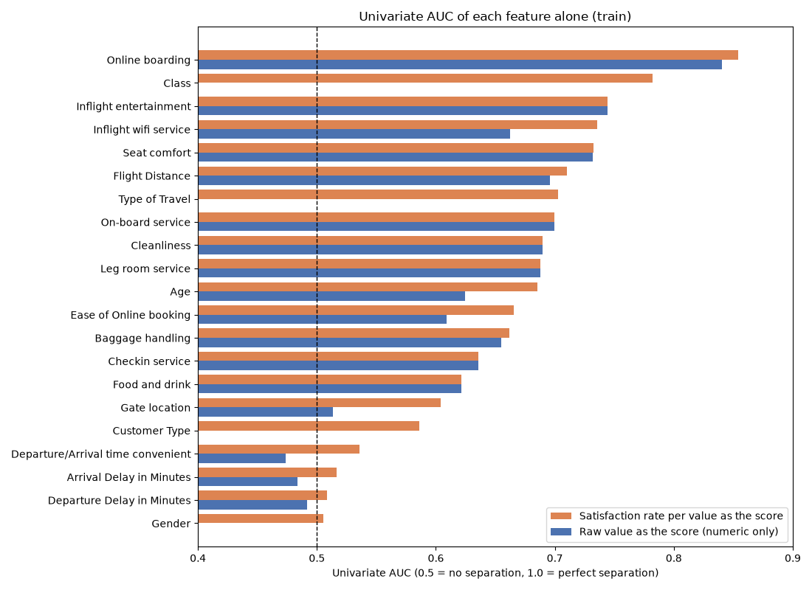
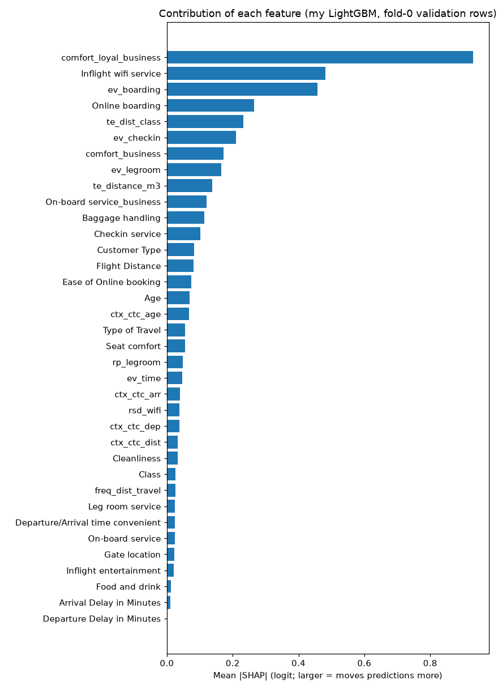

# Kaggle Playground S6E10 — Airline Passenger Satisfaction

> **Summary**
> - **What I did:** in a Kaggle competition predicting passenger satisfaction from a survey, I worked through EDA, feature engineering, five model types and stacking, and made every adopt/reject decision myself.
> - **Result:** rank 52 of 3,748 teams (top 1.4%). I chose the final submission by CV (my own validation score) rather than the Public LB, moving from Public rank 513 to Private rank 52.
> - **Strength:** backing decisions with verification — measuring noise before setting adoption thresholds, isolating causes with control experiments, and recording my wrong calls and a too-loose threshold as lessons.

Binary classification: predict whether a passenger answered "satisfied" from a survey (age, class, type of travel, flight distance, delays and 14 service ratings on a 0–5 scale). Metric: **AUC**. The data is synthetic, generated from a real airline survey; train 699,635 rows, test 299,844 rows.

日本語版: [README.md](README.md)

## Results

**Final: Private LB 0.96239, rank 52 / 3,748 teams (top 1.4%).** The Public rank was 513.

| Submission | Private LB | Public LB |
|---|---|---|
| **(1) Best stack by CV (226 predictions combined into one), selected** | **0.96239** | 0.96182 |
| (2) Hedge: (1) blended 1:1 with another participant's public LB–tuned submission file, selected | 0.96236 | 0.96202 |

The submission chosen by CV, (1), was my best Private score among all submissions.

### Score breakdown (where the rank improved)

Private LB of the submission at each stage, placed on the final leaderboard (details of each stage are in the sections below).

| Stage | Private LB | Equivalent rank |
|---|---|---|
| Baseline (LightGBM, 20 raw columns) | 0.95910 | ~2,860 (top 76%) |
| + Feature engineering (LightGBM, 31 columns) | 0.96102 | ~1,760 (top 47%) |
| + Blend with a different kind of model (RealMLP) | 0.96192 | ~1,170 (top 31%) |
| + 5-model stack (only models I trained) | 0.96208 | ~1,090 (top 29%) |
| + Stack including inspected public OOF predictions (final) | **0.96239** | **52 (top 1.4%)** |

Models I trained myself reached the top 29%; the remaining gap to the top 1.4% (+0.00031) came from adding OOF predictions published by other participants.

### Why it reached the top 1.4%

Differences at the top are tiny (0.00031 between my own models and the final submission), and the Private rank still contains some luck. This section shows the decisions that determined the rank and that their reasoning held on the Private LB.

1. **Features came from EDA findings:** findings such as "how ratings work depends on the customer segment" and "flight distance behaves like a route ID" became features, raising LightGBM from 0.95846 to 0.96046 (→ [What the EDA found](#what-the-eda-found), [What worked](#what-worked)).
2. **No decision from a single run:** after measuring that changing the fold split alone moves a difference by about 0.00005, I adopted a feature only if it improved by +0.00003 on average over three fold splits and in at least two of them (→ [Validation](#validation)).
3. **Time went to model diversity, not tuning (judged by the correlation between model predictions):** tuning raised LightGBM alone by +0.00041, but only +0.000046 after blending. Checking rank correlations between predictions (closer to 1 = more alike) showed that the correlation between the tuned LightGBM and the RealMLP it was blended with had risen from 0.962 to 0.970: tuning had made LightGBM resemble RealMLP, so most of the gain overlapped. Tree models were already highly correlated with each other (0.980–0.992), so adding more trees could not help. TabPFN, which works differently from trees, had correlations of only 0.961–0.965 with them, and adding it raised the 4-model stack by +0.000140 (improved on all 5 folds).
4. **Public OOF predictions were inspected and added under a fair yardstick:** a survey of top public notebooks showed that "the gap to the top comes from the number and variety of models, not technique". I inspected the public OOF predictions and added them one at a time, checked over three seeds (OOF +0.00038, and +0.00043 on the LB) (→ [How public OOF predictions were added](#how-public-oof-predictions-were-added)).
5. **The final submission was chosen by CV, not the Public LB:** the Public LB (~60k rows) cannot resolve differences below 0.0003, so I chose by OOF (700k rows). The CV-chosen (1) became my best Private score, moving from Public rank 513 to Private rank 52.



## Workflow

| Stage | What I did | Main result (OOF AUC) |
|---|---|---|
| EDA | Univariate AUC, cross tables, the meaning of a 0 rating, per-segment heatmaps | Found that ratings work differently by customer segment |
| Feature engineering | Add features one at a time to LightGBM, judged over three fold splits | 20 raw columns 0.95846 → with features 0.96046 (default hyperparameters) |
| Models | LightGBM, XGBoost, CatBoost, RealMLP, TabPFN (RealMLP and TabPFN reproduced from public notebooks) | Single models 0.9608–0.9611 |
| Hyperparameter tuning | Optuna (LightGBM, XGBoost; CatBoost on Kaggle GPU) | LightGBM alone +0.00041, only +0.000046 after blending → switched to adding different kinds of models |
| Ensemble | Logistic-regression stacking on logits (evaluated fairly on a separate split) | 5 models 0.961685 (most of the gain from TabPFN) |
| Public OOF | Added inspected public OOF predictions; second level = 80% logistic regression + 20% shallow LightGBM | 226 members 0.962266 |

## What the EDA found

Full steps and plots are in [notebooks/EDA.ipynb](notebooks/EDA.ipynb) (8 sections, with outputs). The main figures, findings and the measures they led to are below.

#### Figure 1: Class × Type of Travel

- **Purpose:** passenger share and satisfaction for each class × travel-type combination, and how flight distance changes it
- **Top:** vertical axis = class, horizontal axis = travel type. Left = share of passengers (%), right = satisfaction rate (redder = higher)
- **Bottom:** vertical axis = satisfaction rate, horizontal axis = flight-distance bin. One line per combination (6 segments)



- **Finding 1: only "business class on a business trip" is highly satisfied.** That combination is 73.2%; personal travel is 9.5–11.2% in every class (top right).
- **Finding 2: most of the flight-distance effect is a customer-segment effect.** Overall, longer flights look more satisfied (univariate AUC 0.696 with the raw distance as the score), but within the 6 segments the same measure drops to 0.44–0.59. For economy business travelers, satisfaction falls with distance (bottom).
- **→ Measure:** since distance works differently by class, I added "satisfaction rate per distance × class" (+0.00001, adopted but small). Distance itself gave the largest gain as a per-value satisfaction rate (target encoding, +0.00136; [What worked](#what-worked)).

#### Figure 2: Satisfaction by rating, per travel type (4 items shown)

- **Purpose:** whether the same rating means the same satisfaction for business and personal travelers
- **Each panel:** vertical axis = travel type (top = business, bottom = personal), horizontal axis = rating (0–5), number and color = satisfaction rate (%, greener = higher)



- **Finding 3: how service ratings work depends on the segment.** Business travelers rise to 70–85% satisfied at ratings 4–5, while personal travelers stay around 10% at every rating (AUC 0.72–0.79 vs 0.50–0.51).
- **→ Measure:** I built "gated features" that keep a rating only for the segment where it matters and set it to missing otherwise. The same column without the gate did not help (no better than a random column), and a direct comparison gave +0.00021 for the gated version, confirming that the effect comes from the gate. The version restricted to loyal business travelers became the top feature by SHAP.

#### Figure 3: Satisfaction of passengers who rated 0, 1 and 5

- **Purpose:** whether a 0 is the worst rating or "no rating"
- **Left:** vertical axis = service item, horizontal axis = satisfaction rate. Bar color = rating given to that item (blue 1, red 0, green 5)
- **Right:** horizontal axis = average rating that people who gave 0 or 1 gave to the other items



- **Finding 4: a 0 is not always the worst rating.** For Wi-Fi, online booking and online boarding, the 0 group (red) is more satisfied than the 1 group (blue) — 88.7% vs 39.1% for Wi-Fi — so a 0 most likely means "not used". For seat comfort, food and similar items, red and blue are about the same, so 0 is the worst rating.
- **→ Measure:** per-item 0 flags scored −0.00002 and were rejected. I confirmed why: a tree can isolate 0 ratings with a single split (rating ≤ 0.5), and the model already estimated their satisfaction correctly (prediction minus actual within ±0.005). The "number of 0 ratings", which spans several items and cannot be built with one split, was adopted (+0.00001).

#### Figure 4: Univariate AUC per feature

- **Purpose:** which features are strong signals on their own
- Vertical axis = feature, horizontal axis = univariate AUC (0.5 = random, 1 = perfect). Blue = raw value, orange = satisfaction rate per value



## What worked

| Measure | Why I tried it | Gain (OOF AUC) | Why I think it worked |
|---|---|---|---|
| Per-value satisfaction rate of flight distance (target encoding) | Checked beforehand: using the satisfaction rate of each individual distance value gave a univariate AUC of 0.741, higher than 10 bins (0.703) or the raw value (0.696) = each value has its own satisfaction quirk | +0.00136 | Distance has only 3,474 distinct values, each behaving like a route ID with its own satisfaction quirk. A tree would need thousands of splits to learn this from the raw value. The Public LB also rose by +0.00122 (94% of the OOF gain) |
| Gated features (ratings kept only for the segment where they matter) | EDA finding 3 (Figure 2) | +0.00005 to +0.00009 each | Ratings from personal travelers are noise, so keeping values only for the relevant segment makes them easy for trees to use. The top SHAP feature |
| Expected rating predicted from the other 20 columns (no target used) | Idea from a public notebook | +0.00004 to +0.00009 each for 4 items | Among people giving the same 4, those who rated below their expected value were less satisfied (93% → 30%) |
| Route-level mean ratings, within-segment deviations | Ideas from a discussion and a public notebook | +0.00004 to +0.00006 | Summaries a tree cannot build in one split |
| Blending trees with different kinds of models (RealMLP, TabPFN) | Tree models were highly correlated with each other (0.98–0.99) | LB +0.001 | Rank correlation with trees was 0.96, so they can fix rows the trees get wrong |
| Stacking with public OOF predictions | Survey of top public notebooks | First 123 members +0.00038 (LB +0.00043); +0.00058 in total with the final 226 | Added kinds of models I could not build myself (tabular foundation models, improved TabPFN variants, etc.) |



## What didn't work (selected)

- Adding the original real dataset as extra training rows: −0.00017.
- Digits of numbers, GPT-2 token splits, multiplicative interactions: no gain on top of target encoding.
- TabM (another neural network): its predictions were the most different from the other models (rank correlation 0.94), but it was 0.0024 weaker on its own and got no weight. Being different is only one of the conditions for helping.
- Dropping stack members with negative coefficients: −0.00015. A negative coefficient offsets similar members and does not mean the member is useless.
- **(Exception) Dropped, but it actually worked — the "teacher":** a model trained on the original data whose prediction is used as one feature. It improved OOF by +0.00031 but lowered the Public LB by 0.00020, so I dropped it. After the competition the Private LB showed +0.00025, so dropping it was a mistake — the one major decision I let the Public LB drive.

## How public OOF predictions were added

I added OOF predictions published by other participants (a set of train predictions and test predictions) to my stack. Blending them is easy, but low-quality or optimistic predictions (made while looking at the answers) can raise only the CV score and then collapse on the Private LB. So I proceeded in this order:

1. **Research:** in top public notebooks, top participants stated that "the difference is not technique but the number and variety of other people's models you blend". I judged it worth adding model families my five models lacked (tabular foundation models, etc.).
2. **Inspect:** for the 124 members, I checked that row counts matched train and test (no misaligned rows), that there were no missing or out-of-range values, and that the mean test prediction was not far from the mean OOF prediction (train and test share the same distribution, so correctly built predictions give nearly the same mean). One member had a higher AUC than my whole stack and a mean of exactly 0.5 (a probability would average close to the ~44% satisfaction rate; 0.5 is what you get when predictions are converted to ranks and blended), so I treated it as an already-blended result and excluded it: its content overlaps other public OOFs and its OOF may be optimistic.
3. **Measure fairly:** the second level was trained and scored on a split different from the one used for the OOF predictions. Adding 123 members gave OOF +0.00038, and the LB moved by the same amount (+0.00043), so there was no sign of collapse from optimistic OOFs.
4. **Check each blending setting separately:** each was tried as its own experiment.
   - **Regularization strength:** compared seven values (C=0.0003–0.03); C=0.003 was best → adopted
   - **Pruning similar members:** removing members with near-identical predictions (correlation ≥ 0.999) changed nothing; lowering the threshold to 0.998 also removed strong members (−0.000127) → rejected
   - **Dropping the 49 LightGBM-family members:** +0.000014 on all three seeds. As a control, dropping 48 random members made it worse, confirming the gain came from "being LightGBM family" rather than "fewer members" → adopted
5. **Add new public OOFs one at a time:** OOFs published late in the competition were also judged one at a time over three seeds and added only if they improved, giving 226 members.
6. **Keep LB-tuned files out of the main submission:** submission files tuned while watching the Public LB have no OOF and cannot be measured by CV, so I used them only in the hedge (2), never in the main submission (1).

## Ensemble (second level) design

(1) combines 226 predictions — five models I trained myself (LightGBM, XGBoost and CatBoost implemented by me; RealMLP and TabPFN reproduced from public notebooks) plus public OOF predictions — into one prediction with a second-level model. The second level blends two models 80:20.

- **Logistic regression (80%):** combines the 226 predictions as a weighted sum. Stable, but it can only add.
- **Shallow LightGBM (20%):** can learn conditional rules such as "when these two predictions disagree, trust this one". The trees are kept shallow (15 leaves, at least 2,000 rows per leaf) and strongly regularized to avoid overfitting. The 80:20 ratio was taken from the public notebook as is, because re-selecting it on my own OOF would inflate the score.
- Adding LightGBM improved OOF by only +0.000006, but it improved under all three fold splits, so it was kept.

**Why logistic regression is the main second-level model:**

1. **Same as the top public notebooks:** all seven top public notebooks I surveyed used logistic regression on logit-transformed predictions as the second level.
2. **Slightly better in a fair comparison:** I compared it with the other common method, a weighted rank average: convert each model's predictions to ranks, try every combination of model weights (e.g. 0.6:0.4) in steps of 0.1, and average with the best-scoring combination. With five models, logistic regression scored 0.961685 and the weighted rank average 0.961646 (+0.000039). Note that both methods choose their weights by looking at the answers, so scoring on the same data used to choose the weights inflates the score. I therefore split the training data (~700k records) into five groups and, for both logistic regression and the weighted rank average, chose the weights on four groups and scored on the remaining one.
3. **It can set weights for many predictions:** a brute-force weight search like the weighted rank average has far too many combinations with 226 predictions, whereas logistic regression computes all 226 weights at once.
4. **It keeps weights from becoming extreme when predictions are similar:** with many near-duplicate predictions, weights tend to take extreme values (a large positive weight on one and a large negative weight on another) and overfit the training data. L2 regularization (which keeps weights from growing too large) prevents this. Among seven strengths, C=0.003 was best; too strong (0.0003) also shrank the weights of strong models (−0.000072), and too weak (0.03) let the weights of similar predictions blow up (−0.000031).
5. **Better than LightGBM alone:** LightGBM alone as the second level scored 0.96204, below logistic regression (0.96225), so LightGBM is used only as a 20% helper.

**What the hedge (2) is:** another participant's submission file that had been tuned while watching the Public LB (Public 0.96213). It has no OOF, so it cannot be evaluated by CV. (1) and that file were each converted to prediction ranks (0–1) and averaged 0.5:0.5. The 0.5 was fixed in advance so as not to fit the Public LB. Because the final rank uses the better Private score of the two slots, I submitted one CV-trusting file (1) and one Public-LB-trusting file (2).

## What I learned from other participants and adopted

I did not use ideas from public notebooks and discussions as is. I split them into single elements and checked each with my own CV before adopting it; ideas that did not help were not adopted.

| Idea | Source | How I checked it | Decision |
|---|---|---|---|
| All-categorical CatBoost (+ no target encoding) | Public notebook (reported +0.00015) | Tested "all columns categorical" and "drop target encoding" separately: +0.000187 and ±0 | Adopted only the all-categorical part; attributed the reported gain to it |
| Segment statistics (48 columns) | Public notebook (reported +0.00015) | Reduced to 4 deviation columns, judged over three seeds (+0.0000375); versions grouped by boarding / Wi-Fi rejected | Adopted the 4 columns only |
| Route profile (treat distance as a route ID) | Discussion | Tried route-level mean ratings for 3 items; only leg room improved over three seeds (+0.000061) | Adopted leg room only |
| Expected ratings (rating predicted from other columns) | Public notebook | Judged 11 items one at a time over three seeds | Adopted 4 items |
| Blending a shallow LightGBM into the second level | Public notebook | Kept the 0.2 ratio without re-selecting it; +0.000006 over three seeds (3/3 improved) | Adopted |
| Per-family logit scaling (TabPFN ×3, etc.) | Public notebook | Compared seven scalings over three seeds; none improved on all three | Rejected (judged to be optimal only for that notebook's stack) |
| Per-family regularization strength | Public notebook | Searched on one split and confirmed on another; equivalent to dropping the LightGBM family, no extra gain | Rejected |
| Original-data teacher | Three public notebooks (reported +0.00055 to +0.00072) | +0.00026 over three seeds, +0.00038 in total with the public notebook's settings | Adopted → dropped because of the Public LB (a mistake; see [What didn't work](#what-didnt-work-selected)) |
| Public LB–tuned submission files | Public submission files | No OOF, cannot be measured by CV | Kept out of the main submission; used only in the hedge (2) |

## Validation

- 5-fold StratifiedKFold (seed 42). Comparisons always use the same folds and the same rows.
- **A feature is adopted only if it improves by +0.00003 on average over three fold splits and in at least two of them.** Changing the fold split (seed) alone moved the difference for the same feature by a standard deviation (σ) of about 0.00005. Averaging three splits reduces this to σ/√3 ≈ 0.00003, so features above that were adopted.
- **In hindsight, this threshold was loose:** a feature with zero effect still clears it about 16% of the time. Indeed, five features adopted just above the threshold, added together, gave almost no gain on seeds not used for adoption. In the next competition I tightened the threshold to two noise units (about 3% chance adoption) and run only borderline candidates on five seeds.
- Stacking is evaluated on a separate 5-fold split (seed 7): the blend is learned on four folds and scored on the remaining one.
- The Public LB (~60k rows) cannot resolve differences below 0.0003, so decisions were made on OOF (700k rows).
- Checked after the competition: the direction of the difference between two submissions agreed with the Private LB 98% of the time for OOF and 92% for the Public LB (21 submissions, 206 pairs).

## My own work vs. external resources

- **Implemented by me:** EDA, all feature-engineering code, the three-seed adoption procedure, training and tuning of LightGBM, XGBoost and CatBoost, and stacking with its evaluation. Code is in `src/` and `experiments/`.
- **Ideas taken from public notebooks and re-implemented in my own code:** original-data teacher, expected-value features, route profile, segment statistics, all-categorical CatBoost, and blending a shallow LightGBM into the second level (ewtherka).
- **Reproduced from public notebooks (code not included in this repository):** the RealMLP configuration (yekenot) and the TabPFN memory workaround (hemingweb).
- **Used as-is (not included):** published OOF predictions from about 20 Kaggle datasets (cdeotte and others) as stack members in the final submission.
- **Final submission:** slot 1 is the best stack by CV (Private 0.96239). Slot 2 is a hedge: slot 1 and another participant's public LB–tuned submission file, each converted to ranks and averaged 1:1 (Private 0.96236). Slot 2 has no CV backing and did slightly worse on the Private LB.

## Lessons learned

1. With synthetic data, first suspect per-value quirks. Per-value target encoding was the single largest gain.
2. EDA findings such as "the effect depends on the customer segment" translate directly into features.
3. Add models to an ensemble that are both different and strong. Tuning gains shrank to 1/5–1/10 after blending.
4. The gap to the top came from the number and variety of models. Check early whether public OOF predictions exist, and inspect them before use.
5. Confirm small differences over several splits and do not chase small Public LB differences. Here, trusting CV moved the final rank from 513 (Public) to 52 (Private). Conversely, the teacher I dropped because of the Public LB did help on the Private LB.
6. Set the adoption threshold by calculating how often chance alone would pass it, given the measured noise. My "one noise unit" threshold let about 16% of zero-effect features through, and the features adopted just above it did not help when combined.

## Repository layout

```
src/            lgb_fe_check.py (features + LightGBM + three-seed judgment), aux_expected_value.py,
                xgb_check.py, catboost_kaggle.py (Kaggle GPU), stack_check.py (stacking evaluation)
experiments/    lgb_forward_add.py, lgb_optuna.py, shap_report.py
notebooks/      EDA.ipynb (with outputs)
docs/           review_ja.pdf (52-slide review deck, Japanese), img/ (figures; *_en.png are English versions), make_figures_en.py
```

## How to reproduce

```bash
uv sync
# Download train.csv and test.csv from the competition page into data/
python src/lgb_fe_check.py --help          # each script's docstring explains its purpose and usage
python src/aux_expected_value.py --col "Online boarding" --name boarding
python src/lgb_fe_check.py --fe none --export-fe   # writes data/fe36_*.csv, the input of catboost_kaggle.py
```

Run scripts from the repository root.

## About development

Analysis and implementation were done with an AI coding assistant (Claude Code). I decided which experiments to run and which results to adopt, and kept my own experiment log.
