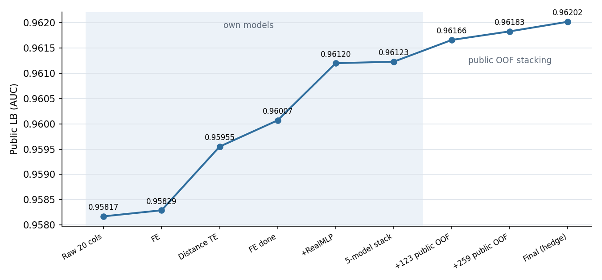
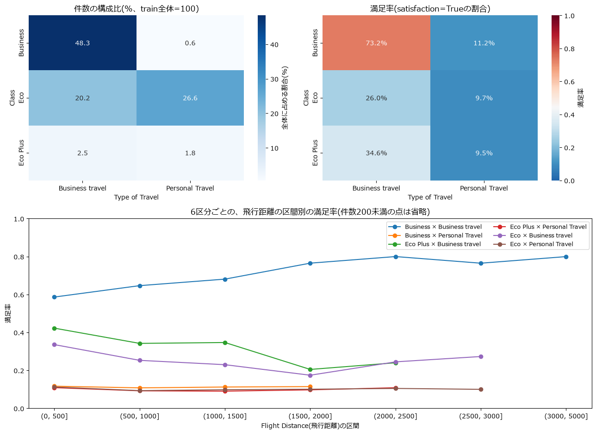
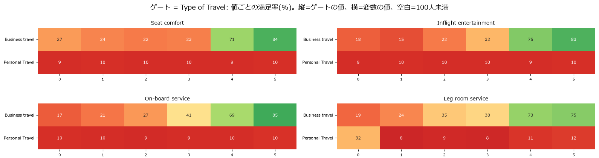
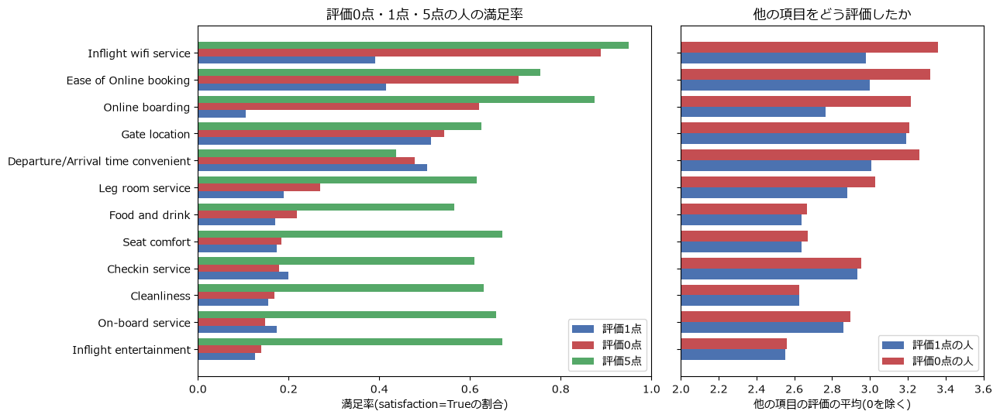
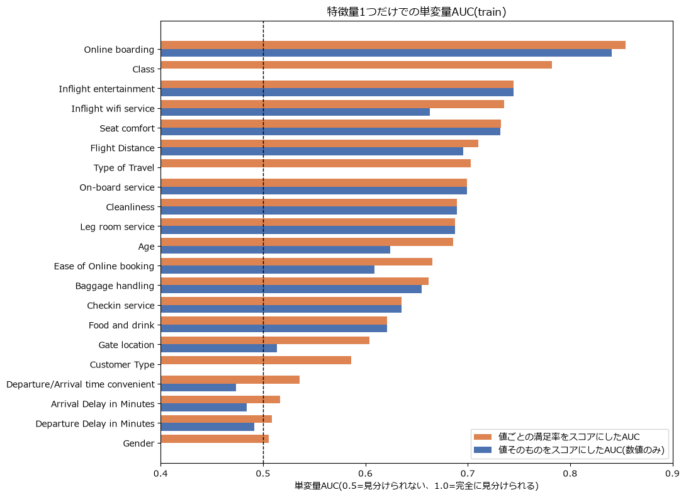
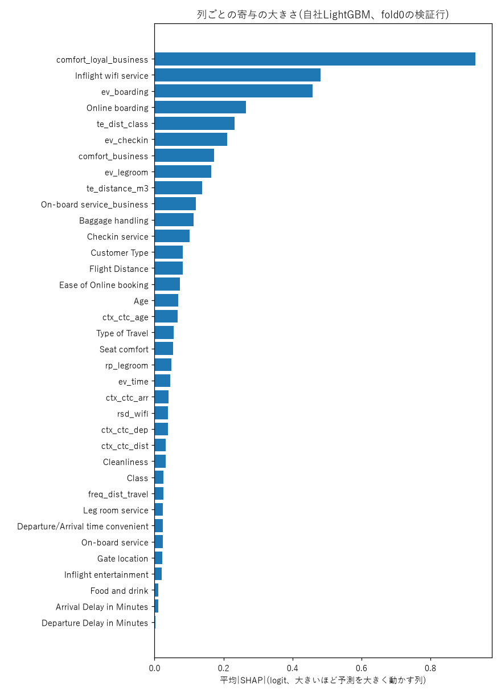

# Kaggle Playground S6E10 — 航空会社の乗客満足度予測

乗客アンケート(年齢・座席クラス・旅行目的・飛行距離・遅延・サービス評価14項目(0〜5点))から、その乗客が「満足」と答えたかを当てる二値分類。評価指標は**AUC**。データは実在の航空会社アンケートを元にした人工データで、train 699,635行・test 299,844行。

English version: [README.md](README.md)

## 結果

**最終結果: Private LB 0.96239、52位 / 3,748チーム(上位1.4%)。** 他の参加者が公開したOOF予測を、自分のモデルと一緒にスタッキングして到達しました。Publicでは513位でした。

| 提出 | Private LB | Public LB |
|---|---|---|
| **① CVで最良のスタック(226本の予測を1つにまとめたもの)、最終提出に選択** | **0.96239** | 0.96182 |
| ② 保険: ①と、公開LBに合わせて作られた他の参加者の提出ファイルを1:1で混ぜたもの、最終提出に選択 | 0.96236 | 0.96202 |

- **①の中身:** 自分で学習した5種類のモデル(LightGBM・XGBoost・CatBoostは自分で実装、RealMLP・TabPFNは公開ノートブックの再現)の予測と、他の参加者が公開したOOF予測を合わせた226本を、もう1段のモデル(2段目)で1つの予測にまとめました。2段目は2つのモデルの答えを8:2で混ぜています。
  - **ロジスティック回帰(8割):** 226本の予測を「重み付きの足し算」でまとめます。安定していますが、足し算しか表せません。
  - **浅いLightGBM(2割):** 「この予測とこの予測の意見が割れたら、こちらを信じる」のような、条件による使い分けを学べます。当てはめすぎを防ぐため、木を浅くし(葉15枚・葉の最小行数2000)、正則化を強めました。8:2の比率は、手元のOOFで選び直すと点数が甘く出るため、公開例の値をそのまま使いました。
  - LightGBMを混ぜた改善はOOFで+0.000006と小さいものでしたが、3通りのfoldの分け方すべてで改善したため採用しました。
  - **2段目の主役をロジスティック回帰にした根拠:**
    1. **上位の公開例と同じ:** 上位の公開ノートブック7本を調べると、2段目はすべて「予測をlogit(対数オッズ)に直してからのロジスティック回帰」でした。
    2. **公平に比べて少し上:** よく使われるもう1つの混ぜ方「順位の重み付き平均」と比べました。これは、各モデルの予測を順位に直し、各モデルの重み(例: 0.6:0.4)を0.1刻みで総当たりで調べて、最も良く当たる組み合わせを選んで平均する方法です。2つを比べた結果、5モデルではロジスティック回帰が0.961685、順位の重み付き平均が0.961646で、ロジスティック回帰が+0.000039上でした。なお、どちらの混ぜ方も答えを見て重みを決めるため、重みを決めたデータでそのまま採点すると点数が甘く出ます。そこで、trainのデータ(約70万件)を5つのグループに分け、4グループで重みを決めて残り1グループで採点する方法を、ロジスティック回帰と順位の重み付き平均の両方で行いました。
    3. **本数が多くても重みを決められる:** 順位の重み付き平均のように重みを総当たりで調べる方法は、226本では組み合わせが多すぎて使えません。ロジスティック回帰は、226本の重みを計算で一度に決められます。
    4. **似た予測が多くても重みが偏りにくい:** ほぼ同じ予測が何本もあると、重みが極端な値(片方に大きなプラス、もう片方に大きなマイナス等)になり、手元のデータに合わせすぎた予測になりがちです。ロジスティック回帰は正則化(重みが大きくなりすぎないようにする仕組み)でこれを抑えられます。正則化の強さCを7通り比べ、C=0.003が最良でした。強すぎる(0.0003)と強いモデルの重みまで縮んで−0.000072、弱すぎる(0.03)と似た予測の重みが暴れて−0.000031でした。
    5. **LightGBMだけより上:** LightGBMだけを2段目にすると0.96204で、ロジスティック回帰(0.96225)より低くなりました。そのため、LightGBMは主役ではなく2割の補助にしました。
- **②の中身:** 公開LBを見ながら調整された、他の参加者の提出ファイル(公開LB 0.96213)を使いました。このファイルにはOOFが無いため、CVでは良し悪しを測れません。①と相手のファイルを、それぞれ予測の大きさの順位(0〜1)に直してから0.5:0.5で平均しました。0.5は、公開LBに合わせないために固定した値です。最終順位は2枠のうちPrivateが良い方で決まるので、「CVを信じる①」と「公開LBを信じる②」の両方を出しました。

CVで選んだ提出が、全提出の中でPrivateの最高点でした。保険はPublicでは上でしたが、Privateでは下でした。公開LBに合わせたファイルを出した多くのチームは、Privateで順位を下げました。



## 取り組みの流れ

| 段階 | やったこと | 主な結果(OOF AUC) |
|---|---|---|
| EDA | 特徴量ごとの単変量AUC、クロス集計、評価「0点」の意味、客の種類ごとのヒートマップ | 評価の効き方が客の種類で変わることを発見(例: 快適さは常連の出張客にだけ効く) |
| 特徴量エンジニアリング | LightGBMで1列ずつ足し、CVの分け方3通りで判定 | 生の20列 0.95846 → 特徴量込み 0.96046(既定ハイパラ) |
| モデル | LightGBM・XGBoost・CatBoost・RealMLP・TabPFN(RealMLP・TabPFNは公開ノートブックの再現) | 単体 0.9608〜0.9611 |
| ハイパラ調整 | Optuna(LightGBM・XGBoost、CatBoostはKaggleのGPU) | LightGBM単体+0.00039、ただし混ぜると+0.00005 |
| アンサンブル | logitを入力にしたロジスティック回帰のスタッキング(別の分け方で公平に評価) | 5モデルで0.961685 |
| 公開OOF | 他の参加者が公開した予測をスタックのメンバーに追加し、2段目をロジスティック回帰8割+浅いLightGBM 2割に | 226本で0.962266 |

### EDAで分かったこと

詳しい手順とグラフは[notebooks/EDA.ipynb](notebooks/EDA.ipynb)(全8節、出力付き)にあります。主な発見を4つ、対応する図と一緒に示します。

**発見1・2 → 図1(座席クラス×旅行目的)**

- **発見1: 満足率が高いのは「出張でビジネスクラス」の組み合わせだけ。** Business×出張は73.2%ですが、私用旅行はクラスに関係なく9.5〜11.2%です(ビジネスクラスでも私用なら11.2%)。図1の右上で見えます。
- **発見2: 飛行距離の効き目の多くは、客層の違いの表れだった。** 全体では「長距離ほど満足」(値の大小で測った単変量AUC 0.696)に見えますが、座席クラス×旅行目的の6区分の中では、同じ測り方で0.44〜0.59に下がります。エコノミーの出張客では、逆に長距離ほど満足率が下がります。図1の下段(6区分ごとの距離別の満足率)で見えます。



**発見3 → 図2(旅行目的ごとの、評価の点数別の満足率)**

- **発見3: サービス評価の効き方は客層で変わる。** 座席・機内エンタメ・機内サービスなどの評価は、出張客ではAUC 0.72〜0.79とよく効きますが、私用客では0.50〜0.51とほぼ効きません。図2では、出張客(上の行)は評価が4〜5点になると満足率が70〜85%に上がるのに、私用客(下の行)は点数に関係なく約10%です(4項目を抜粋)。これを元に作ったゲート特徴量(効く客層だけ評価の値を持つ)が、SHAPの寄与で1位になりました。



**発見4 → 図3(評価0点・1点・5点の人の満足率)**

- **発見4: 評価「0点」は最低評価とは限らない。** 機内Wi-Fiの0点の満足率は88.7%で、1点の39.1%よりはるかに高いです。図3の左で、Wi-Fi・オンライン予約・オンライン搭乗は赤(0点)の棒が青(1点)より長く、「使っていないので評価なし」の意味だと考えられます。座席・食事などは赤と青がほぼ同じで、0点は最低評価として使われています。



**参考 → 図4(特徴量ごとの単変量AUC)**

- 特徴量を1つだけ使ったときに、満足/不満をどれだけ見分けられるか(0.5=当てずっぽう、1=完璧)を示します。青は値の大小、橙は値ごとの満足率で測った値です。



### 効いたこと

| 施策 | 改善幅(OOF AUC) | 効いたと考える理由 |
|---|---|---|
| 飛行距離の値ごとの満足率(Target Encoding) | +0.00136 | 距離は3,474種類しかなく、値1つ1つが路線IDのように満足率のクセを持つ。木が生の値から学ぶには数千回の分岐が要る |
| ゲート特徴量(効く客層だけ評価の値を持ち、他は欠損) | 各+0.00005〜+0.00009 | EDAで、快適さの評価は出張客では効く(AUC 0.72〜0.79)が私用客では効かない(約0.50)と分かった。SHAPの1位もこの列 |
| 他の20列から予想した評価の期待値(答えは使わない) | +0.00004〜+0.00009 | 予想より低めに付けた人ほど満足していない |
| 路線ごとの評価の平均、客層グループ内の偏差 | +0.00004〜+0.00006 | 木が1回の分岐では作れない要約 |
| 性格の違うモデル(RealMLP・TabPFN)を木と混ぜる | LB+0.001 | 木との順位相関が0.96(木どうしは0.98〜0.99) |
| 公開OOFを使ったスタッキング | +0.00054(LB+0.0006) | 自分では作れなかった種類のモデル(表の基盤モデル、TabPFNの工夫版など)が加わった |



### 効かなかったこと(抜粋)

- 元の実データを学習の行として足す: −0.00017。元データで学習したモデルの予測を1列にする「先生役」はOOFで+0.00038だったが、Public LBで約−0.0002だったため外した。
- 数値の桁、GPT-2のトークン区切り、掛け算の交互作用: Target Encodingの上では伸びなかった。
- TabM(別のニューラルネット): 他のモデルと最も違う予測だった(順位相関0.94)が、単体が0.0024低く重みが付かなかった。「違う」は効く条件の1つにすぎない。
- スタックで係数がマイナスのメンバーを外す: −0.00015。マイナスの係数は、似たメンバーとの差し引きの役割で、不要という意味ではない。

## 検証の仕方

- 5分割のStratifiedKFold(seed 42)。比較は常に同じfold・同じ行で行う。
- **特徴量は、CVの分け方3通りで差の平均が+0.00003以上、かつ3通り中2つ以上で改善したときだけ採用。** 分け方を変えるだけで差が約0.00005揺れ、1回の結果は信用できなかったため。
- スタッキングは別の5分割(seed 7)で評価し、混ぜ方を4つで学んで残り1つで採点した。
- Public LB(約6万行)は0.0003未満の差を見分けられないので、判断はOOF(70万行)で行った。

## 自分の工夫と外部の活用の区別

- **自分で実装したもの:** EDA、特徴量エンジニアリングのコード全部、3seedでの採否判定の仕組み、LightGBM・XGBoost・CatBoostの学習と調整、スタッキングとその評価。コードは`src/`と`experiments/`にあります。
- **公開ノートブックのアイデアを、自分のコードで実装し直したもの:** 元データの先生役、期待値の列、路線プロファイル、客層グループの統計、CatBoostの全列カテゴリ化、2段目への浅いLightGBMの混合(ewtherka氏)。
- **公開ノートブックを再現したもの(このリポジトリにはコードを含めない):** RealMLPの設定(yekenot氏)、TabPFNのメモリ節約の処理(hemingweb氏)。
- **そのまま使ったもの(含めない):** 約20のKaggleデータセットで公開された予測(cdeotte氏ほか)を、最終提出のスタックのメンバーとして使用。
- **最終提出:** 1枠目はCVで最良のスタック(Private 0.96239)。2枠目は保険で、1枠目と、公開LBに合わせて作られた他の参加者の提出ファイルを、予測の順位に直して1:1で平均したもの(Private 0.96236)。2枠目にはCVの裏付けがなく、Privateではわずかに下でした。

## 学んだこと

1. 人工データでは、まず値ごとのクセを疑う。値ごとのTarget Encodingが単独で最大の改善だった。
2. 客層で効き方が変わるといったEDAの発見は、そのまま特徴量になる。
3. アンサンブルには「違う」かつ「強い」モデルを足す。ハイパラ調整の伸びは、混ぜると1/5〜1/10に縮んだ。
4. 上位との差は、モデルの数と種類から来ていた。公開OOFがあるかは早めに調べる。
5. 小さな差は分け方を変えて複数回確かめ、Public LBの小さな差は追わない。今回はCVを信じたことで、Public 513位からPrivate 52位になった。

## フォルダ構成

```
src/            lgb_fe_check.py(特徴量+LightGBM+3seed判定)、aux_expected_value.py、
                xgb_check.py、catboost_kaggle.py(KaggleのGPU)、stack_check.py(スタッキングの評価)
experiments/    lgb_forward_add.py、lgb_optuna.py、shap_report.py
notebooks/      EDA.ipynb(出力付き)
docs/           review_ja.pdf(振り返りスライド52枚)、img/
```

## 再現手順

```bash
uv sync
# コンペのページからtrain.csvとtest.csvをdata/に置く
python src/lgb_fe_check.py --help          # 各スクリプト冒頭のdocstringに目的と使い方を書いています
python src/aux_expected_value.py --col "Online boarding" --name boarding
```

スクリプトはリポジトリのルートで実行します。

## 開発について

分析と実装は、AIコーディングアシスタント(Claude Code)を使って進めました。どの実験をするか、どの結果を採用するかは自分で判断し、自分の実験記録に残しています。
