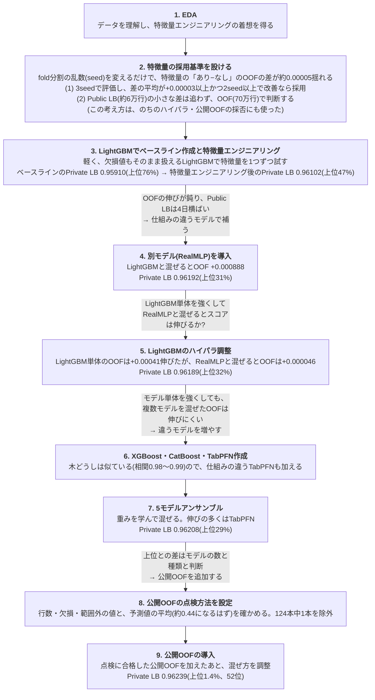
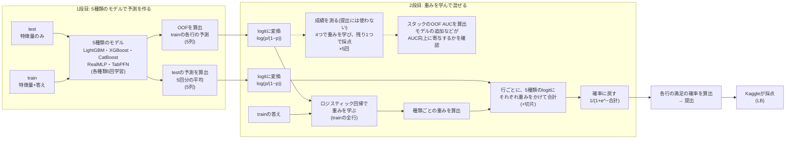
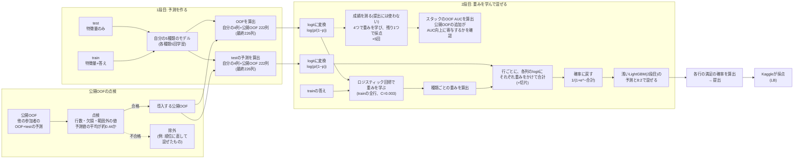

# Kaggle Playground S6E10 — 航空会社の乗客満足度予測

## コンペ概要

| 項目 | 内容 |
|---|---|
| コンペ | Kaggle Playground Series S6E10「Predicting Airline Satisfaction」(2026年10月開催) |
| 課題 | 乗客アンケート(年齢・座席クラス・旅行目的・飛行距離・遅延・サービス評価13項目)から、「満足」と答えたかを当てる二値分類 |
| データ | 人工データ。train 699,635行・test 299,844行 |
| 評価指標 | **AUC**(満足の客を不満の客より上位に並べられたか。1に近いほど良い) |
| 参加 | 3,748チーム。個人で参加 |

## 結果

**Private LB 0.96239、52位 / 3,748チーム(上位1.4%)。**

## コンペの進め方と段階ごとのスコア

段階ごとの詳細は下の各節([1](#1-eda)〜[9](#9-公開oofの導入))に書いた。コードは`src/`の下に、段階と同じ番号のフォルダで置いている(2・4はコードなし)。



## 上位1.4%に届いた考察

1. **ブレを測ってから採否基準を決めた:** 特徴量で決めた「分け方を3通り変えて判定する」考え方を、のちのハイパラや公開OOFの採否にも使い、偶然の改善を採用しないようにした(→[2](#2-特徴量の採用基準を設ける))。
2. **単体モデルの強化より、仕組みの違うモデルの導入に時間を使った:** 5モデルのスタックで重く使われたのは、木と仕組みの違うTabPFN(係数0.42)とRealMLP(0.35)だった(→[5](#5-lightgbmのハイパラ調整)・[7](#7-5モデルアンサンブル))。
3. **公開OOFを点検してから導入した:** 加えたときOOF(+0.00038)とPublic LB(+0.00043)が同じくらい伸び、甘いOOFによる崩れはなかった(→[8](#8-公開oofの点検方法を設定)・[9](#9-公開oofの導入))。
4. **最終提出をCVで選んだ:** Public LB(約6万行)は0.0003未満の差を見分けられない。CVで選んだ提出(Public 513位)が、Privateでは52位になった。

## 1. EDA

EDAでは3つの仮説を確かめ、2つを特徴量にした。①飛行距離の効き目は「出張でビジネスクラス」という客層の表れ → 出張客だけに値を持たせるゲート特徴量と、飛行距離×座席クラスの満足率。②Wi-Fiなどの0点は「評価なし」 → 0点の意味は項目で違ったが、0点の印の特徴量は効かなかった。③客層で評価の効き方が変わる → 常連かつ出張客の快適さ。各節の「なぜ見たか・発見・試したこと」はノートブックに記載している。

**コード:** [src/1_exploratory_data_analysis/EDA.ipynb](src/1_exploratory_data_analysis/EDA.ipynb)

## 2. 特徴量の採用基準を設ける

- 5分割のStratifiedKFold(seed 42)。比較は常に同じ行で行う。
- 基準の+0.00003は、3通りの平均のブレ(0.00005÷√3≈0.00003)。
- **反省:** この基準は緩く、効果ゼロでも約16%が通る。すれすれで採用した5つは、まとめると効いていなかった。次からはブレ2つ分に厳しくした。
- 終了後、提出どうしの差の向きがPrivateと一致した割合は、OOFで98%、Public LBで92%で、OOFで判断したのは正しかった。

## 3. LightGBMでベースライン作成と特徴量エンジニアリング

**元の特徴量(コンペで最初から与えられた21個)**

| 種類 | 特徴量 |
|---|---|
| 乗客 | 性別、年齢、顧客区分(常連 / 常連でない) |
| 旅行 | 旅行目的(出張 / 私用)、座席クラス(ビジネス / エコノミー / エコノミープラス)、飛行距離 |
| 遅延 | 出発遅延(分)、到着遅延(分、一部欠損) |
| サービス評価(13項目、0〜5点) | 機内Wi-Fi、出発・到着時刻の便利さ、オンライン予約のしやすさ、ゲートの場所、食事、オンライン搭乗、座席の快適さ、機内エンタメ、機内サービス、足元の広さ、手荷物の扱い、チェックイン、清潔さ |

### (1) ベースライン

`select_baseline_features.py`で、元の特徴量から土台を決めた。

- 元の特徴量21個を、単変量AUCの高い順にLightGBMへ1つずつ足し、OOFの伸びを測った。
- 20個目まではすべて改善。単独では弱い顧客区分(AUC 0.586)も+0.00113と、組み合わせで効いた。
- 性別だけは−0.00002だったので外し、**20個を土台**にした(OOF 0.95846)。以降の特徴量はこの土台に足して判定した。

**コード:** [src/3_lightgbm_baseline_and_feature_engineering/select_baseline_features.py](src/3_lightgbm_baseline_and_feature_engineering/select_baseline_features.py)

### (2) 特徴量エンジニアリング

候補は1つずつ、土台と「土台+候補」をLightGBM(`train_lightgbm.py --feature 候補名`)で比べ、[2. 特徴量の採用基準](#2-特徴量の採用基準を設ける)の基準で採否を決めた。

**採用した特徴量**(元の特徴量20個+作った特徴量16個=36個。OOF 0.95846→0.96046)。作り方で3つに分け、着想の出どころ(EDA・公開ノートブック・Discussion等)は「着想の根拠」の先頭に書いた。改善幅は、注記のないものは3seed平均。

**① 条件で絞る(ゲート特徴量、3個):** 点数が効く客層だけに値を持たせ、他は空欄にする。

- **出張客の快適さ(ゲート特徴量)**
  - 着想の根拠: EDA: 私用客は快適さに関係なく満足率9〜12%(EDAノートブック5節、特徴量ノートブック1)。ゲートなしの同じ特徴量は効かず、効果はゲートによる
  - 作った特徴量: 快適さ(座席・足元・機内エンタメの点数の平均)を、出張客だけに持たせ、私用客は空欄にする
  - 改善幅: +0.000063
- **常連かつ出張客の快適さ(ゲート特徴量)**
  - 着想の根拠: EDA: 常連でない客には快適さが効かない(EDAノートブック8節)
  - 作った特徴量: 快適さを、常連の出張客だけに持たせ、それ以外は空欄にする
  - 改善幅: +0.000070(SHAPで1位)
- **出張客の機内サービス(ゲート特徴量)**
  - 着想の根拠: EDA: 単変量AUCが出張客0.759、私用客0.509(EDAノートブック5・8節)
  - 作った特徴量: 機内サービスの点数を、出張客だけに持たせ、私用客は空欄にする
  - 改善幅: +0.000045

**② 似た乗客で数える・平均する(9個):** 満足率(Target Encoding)は答えを使うので、自分を除いた乗客で数え、人数が少ない値は全体の満足率に寄せた(極端な値を防ぐ)。

- **飛行距離の値ごとの満足率**
  - 着想の根拠: 事前確認: 値ごとの満足率の単変量AUC(0.741、強さm=20)が元の飛行距離そのもの(0.696)より高かった。距離の値が路線IDのように満足率のクセを持つ
  - 作った特徴量: 同じ飛行距離の乗客のうち、満足した人の割合(Target Encoding。例: この路線の満足率)
  - 改善幅: +0.00136(1seed。最大の改善。強さm=20で入れて+0.00130、m=3に調整して+0.00006。Public LBは+0.00122)
- **飛行距離×座席クラスの満足率**
  - 着想の根拠: EDA: 距離の効き方は客層で違う(EDAノートブック5節)
  - 作った特徴量: 同じ距離で同じ座席クラスの乗客のうち、満足した人の割合(例: この路線のビジネス席の満足率)
  - 改善幅: +0.000060
- **飛行距離×旅行目的の出現回数**
  - 着想の根拠: 前のコンペの経験: 値の出現回数が効いた経験から10種類試し、効いたのはこれだけ
  - 作った特徴量: 同じ距離で同じ旅行目的の乗客が、train+testに何人いるか(例: この路線の出張客の人数)
  - 改善幅: +0.000057
- **足元の広さの路線平均**
  - 着想の根拠: Discussion: 距離を路線IDとみなす
  - 作った特徴量: 同じ飛行距離(=同じ路線とみなす)の乗客の、足元の点数の平均(例: この路線の足元の評判)
  - 改善幅: +0.000061
- **Wi-Fiの路線標準偏差**
  - 着想の根拠: 公開ノートブック: 路線プロファイル。Wi-Fiが0点か5点に偏る乗客の多い路線を表す
  - 作った特徴量: 同じ飛行距離の乗客の、Wi-Fiの点数のばらつき(例: この路線のWi-Fiは評価が割れているか)
  - 改善幅: +0.000048
- **客層グループ内の偏差(4個)**
  - 着想の根拠: 公開ノートブック(48個、+0.00015の報告)を偏差だけの4個に絞った
  - 作った特徴量: 自分の年齢・飛行距離・出発遅延・到着遅延から、同じ客層(座席クラス×旅行目的×常連かどうかの12グループ)の平均を引いた値(例: 同じ客層の中で年上か)
  - 改善幅: +0.0000375

**③ モデルで予想する(4個)**

- **評価の期待値(4項目)**
  - 着想の根拠: 公開ノートブック。同じ4点でも、ほかの項目の答え方から予想した点数(期待値)が低い人は満足率27%、高い人は94%と大きく違う(オンライン搭乗)。11項目を1つずつ判定した
  - 作った特徴量: 他の項目への答え方から、「この人ならこの項目に何点を付けそうか」をモデルで予想した点数(搭乗・足元・チェックイン・時刻の便利さ)
  - 改善幅: 各+0.000037〜+0.000088

**コード:**

採用した13個の特徴量の【仮説】【確認】【結果】【施策】とコードは、[feature_engineering.ipynb](src/3_lightgbm_baseline_and_feature_engineering/feature_engineering.ipynb)で順に追える(学習に使う`feature_definitions.py`と同じ特徴量になることを、ノートブックの最後で全行照合している)。

| スクリプト | 役割 |
|---|---|
| [feature_engineering.ipynb](src/3_lightgbm_baseline_and_feature_engineering/feature_engineering.ipynb) | 採用した特徴量ごとの仮説・確認・結果と、特徴量を作るコード |
| [feature_definitions.py](src/3_lightgbm_baseline_and_feature_engineering/feature_definitions.py) | 採用した特徴量の定義とTarget Encoding。全モデルがここから読み込む |
| [rejected_feature_candidates.py](src/3_lightgbm_baseline_and_feature_engineering/rejected_feature_candidates.py) | 試したが採用しなかった候補(約90個)。`--feature 名前`で判定し直せる |
| [make_expected_rating.py](src/3_lightgbm_baseline_and_feature_engineering/make_expected_rating.py) | 「他の特徴量から予想した評価の期待値」を前もって計算して保存する(重いので判定のたびには計算しない) |
| [train_lightgbm.py](src/3_lightgbm_baseline_and_feature_engineering/train_lightgbm.py) | LightGBMの学習と、特徴量の採否の判定。最終のLightGBMもこれ |
| [analyze_shap.py](src/3_lightgbm_baseline_and_feature_engineering/analyze_shap.py) | 採用した特徴量の効き方をSHAPで確かめる |

### (3) エンコーディングの比較

カテゴリや値の渡し方(エンコーディング)も、ベースラインのあとに1つずつ比べて決めた。

| 比べたもの | 結果 |
|---|---|
| 飛行距離: 値そのまま vs 値ごとの満足率(Target Encoding) | Target Encoding(強さm=20)で+0.00130(特徴量エンジニアリングで最大の改善) |
| Target Encodingの強さ(人数の少ない値を全体の満足率に寄せる強さ m=1・3・5・10・20・50) | m=3〜5が最良(強すぎるm=50は−0.00017)。m=3を採用 |
| 出現回数(Frequency Encoding)の10候補 | 飛行距離×旅行目的だけ採用(+0.000057) |
| CatBoost: 一部の特徴量だけカテゴリ扱い vs 全部をカテゴリ扱い | 全部をカテゴリ扱いで+0.000187(6の節) |
| (試していない)カテゴリ4つ(性別・顧客区分・旅行目的・座席クラス)のOne-Hot | 値が2〜3種類しかなく、木のモデルではカテゴリ型で渡すのとほぼ同じ分け方になるため、優先しなかった |

## 4. 別モデル(RealMLP)を導入

- **導入理由:** 特徴量を足し続けても、OOFの伸びが鈍り(最初の2日で+0.0017、次の4日で+0.00027)、Public LBは0.96002〜0.96007で4日間横ばいになった。木とは仕組みの違うニューラルネット(RealMLP)なら、木が苦手な部分を補えると考えた。
- **公開ノートブックの設定を変えて使った:** 元にしたのはyekenot氏の公開ノートブック『PS|S6|E10: RealMLP · PyTabKit』(pytabkitのRealMLP_TD_Classifier、KaggleのGPU)。変えた点は次の4つ。
  1. 最良のエポック(学習の回数)を、採点用のfoldではなく学習側の5%で選ぶ(`val_fraction=0.05`。採点用のfoldはfitに渡さない)。採点用で選ぶとOOFが甘くなるため。
  2. 5分割の分け方をLightGBMと同じにする(`StratifiedKFold(5, shuffle=True, random_state=42)`)。同じ行どうしで比べ、混ぜられるようにするため。
  3. エポック数を3→4にする(`n_epochs=4`)。
  4. モデルのseed 42と1の2本を作り、予測を平均する(最終で使ったのはこの平均、OOF 0.961192)。
- **結果:** 単体でもOOF 0.961056で、LightGBM(0.960418)を5foldすべてで上回った。Public LBも0.96007→0.96120と、横ばいを抜けた。

**コード:** なし(RealMLPは公開ノートブックの再現のため含めない)

## 5. LightGBMのハイパラ調整

- **調整理由:** RealMLPと混ぜてスコアが伸びたので、次はLightGBM単体を強くすれば、混ぜたスコアもさらに伸びるかを確かめた。
- **やり方:** Optunaで8つのハイパラを同時に50試行。上位3つの設定を3通りの分け方で調整前と比べ、最良の設定の学習率を0.02に下げて採用した。
- **結果:** 単体はOOF 0.960458→0.960869と伸びたが、RealMLPと混ぜると伸びは約1/9に縮んだ。調整後のLightGBMがRealMLPに似て(順位相関0.962→0.970)、伸びた分が重なったため。
- **その後の方針:** 単体モデルの強化より、仕組みの違うモデルを増やす方に時間を使う(→[6](#6-xgboostcatboosttabpfn作成))。

※ のちに6でXGBoost・CatBoostもハイパラ調整したが、単体の伸び(+0.000244・+0.000076)は混ぜると+0.000005・+0.000020に縮み、この方針を裏付ける結果になった。

**コード:** [src/5_lightgbm_hyperparameter_tuning/tune_lightgbm.py](src/5_lightgbm_hyperparameter_tuning/tune_lightgbm.py)

## 6. XGBoost・CatBoost・TabPFN作成

- **作成理由:** 5の結果から、単体を強くするより、混ぜる相手の種類を増やす方が伸びると考えた。木の仲間(XGBoost・CatBoost)に加え、木ともニューラルネットとも仕組みの違うTabPFNを用意した。
- **やり方:**
  - XGBoost: LightGBMと同じ36個の特徴量で学習し、Optunaでハイパラ調整(50試行)。
  - CatBoost: KaggleのGPUで学習し、Optunaでハイパラ調整(30試行)。公開ノートブックの「全列カテゴリ化+TEなし」(+0.00015の報告)を2つに分けて試し、全列カテゴリ化(+0.000187)だけを採用した(TEを外すのは±0)。
  - TabPFN: 事前学習済みの表データ用モデル(TabPFN-3.5、`tabpfn==9.0.0`)。hemingweb氏の公開ノートブック『S6E10 EXP01 TabPFN35 Full Context』を参考にしたため、コードは含めない。
    入力は元の特徴量21個(カテゴリ4個はカテゴリとして指定)、文脈は学習foldの全行、`n_estimators=1`・`random_state=0`。5分割はLightGBMと同じにした。
    KaggleのGPU(T4)で1foldあたり約1.5時間かかる(メモリが足りないので、公開ノートブックと同じく文脈の計算を小分けにする)。
- **結果:** ハイパラ調整で単体はXGBoost +0.000244・CatBoost +0.000076伸びた。5モデルの単体の強さはほぼ同じ(0.9608〜0.9612)で、予測の似かたが違った。木どうし(LightGBM・XGBoost・CatBoost)の順位相関は0.979〜0.992と高く、TabPFNは他の4モデルと0.961〜0.966と低い。

**表: 単体OOFと、モデルどうしの予測の順位相関(1に近いほど似た予測)**

| モデル | 単体OOF | LightGBMとの相関 | XGBoostとの相関 | CatBoostとの相関 | RealMLPとの相関 | TabPFNとの相関 |
|---|---|---|---|---|---|---|
| LightGBM(5でハイパラ調整) | 0.960869 | − | 0.992 | 0.984 | 0.970 | 0.965 |
| XGBoost | 0.960762 | 0.992 | − | 0.979 | 0.966 | 0.961 |
| CatBoost | 0.960936 | 0.984 | 0.979 | − | 0.971 | 0.964 |
| RealMLP(4で導入) | 0.961192 | 0.970 | 0.966 | 0.971 | − | 0.966 |
| TabPFN | 0.960844 | 0.965 | 0.961 | 0.964 | 0.966 | − |

- **その後の方針:** 5モデルを、重みを学んで混ぜる(→[7](#7-5モデルアンサンブル))。

**コード:**

| スクリプト | 役割 |
|---|---|
| [train_xgboost.py](src/6_xgboost_catboost_models/train_xgboost.py)・[tune_xgboost.py](src/6_xgboost_catboost_models/tune_xgboost.py) | XGBoostを同じ特徴量で学習し、混ぜる価値を診断する。Optunaでハイパラ調整 |
| [train_catboost.py](src/6_xgboost_catboost_models/train_catboost.py)・[tune_catboost.py](src/6_xgboost_catboost_models/tune_catboost.py) | CatBoostを学習する(KaggleのGPU)。Optunaでハイパラ調整 |

## 7. 5モデルアンサンブル

- **アンサンブル理由:** 6で、単体の強さはほぼ同じで予測の似かたが違う5モデルがそろった。混ぜれば得意・不得意を補い合い、AUCが上がると考えた。
- **やり方:** 2段階で混ぜる(スタッキング)。
  - 1段目: 5モデルとも同じ5分割で学習し、OOF(各行を、その行を学習していないモデルで予測した値)とtestの予測を作る。
  - 2段目: OOFのlogitから、答えに一番合う重みと切片をロジスティック回帰で学ぶ(重みの合計は1ではなく、平均とは違う)。調べた上位の公開ノートブック7本が、2段目をすべてこの方法(logitのロジスティック回帰)にしていたので合わせた。
  - 公平に測る: 重みを決めた行で採点すると点数が甘くなるので、「4つで重みを学び、残り1つで採点」を5回くり返してスタックのOOF AUCを出し、モデルの追加などの判断に使った。提出用は全行で学び直した。

**図: アンサンブルの流れ(1段目・2段目の入力と出力)**



- **最適化のために試したこと:**
  - 2段目のロジスティック回帰を、順位の重み付き平均と比べた。
  - 1モデルずつ抜いて、スタックのOOFを比べた(どのモデルが効いているかを見るため)。
- **結果:**
  - 5モデルのスタックで**OOF 0.961685**。ロジスティック回帰は、順位の重み付き平均より+0.000039高かった。
  - 2段目が学んだ係数: TabPFN 0.42、RealMLP 0.35、CatBoost 0.13、LightGBM・XGBoost 各0.05。
  - 1モデルずつ抜いたときの変化: RealMLP −0.000188、TabPFN −0.000141、CatBoost −0.000028、XGBoost −0.000007、LightGBM ±0。
- **考察:**
  - 2段目はロジスティック回帰にした。モデルの本数が増えても、正則化で重みの偏りを抑えられる。
  - 仕組みの違うRealMLPとTabPFNが重く使われ、抜くと大きく下がった。木との順位相関が0.961〜0.971と低く、木が間違える行を補えたと考えられる(推測。行ごとには確かめていない)。
  - LightGBMは抜いても変わらなかった。XGBoost・CatBoostと予測が似ていて(相関0.98〜0.99)、役割が重なっていた。

- **その後の方針:** 上位との差は混ぜるモデルの数と種類と判断し、公開OOFを加える(→[8](#8-公開oofの点検方法を設定)・[9](#9-公開oofの導入))。

**コード:** [src/7_stacking_ensemble/evaluate_stacking.py](src/7_stacking_ensemble/evaluate_stacking.py)

## 8. 公開OOFの点検方法を設定

- **公開OOFとは:** 他の参加者が公開した、OOFとtestの予測のセット。**予測の値だけ**なので、中のモデルの数や分け方は公開した人しだい。それでも、OOFが「その行を学習していないモデルの予測」になっていれば、2段目からは**列が1本増えるだけ**で、7の仕組みにそのまま入れられる。
- **点検理由:** 作り方が見えないので、正しく作られていないもの(OOFが甘いもの等)を混ぜると、手元のOOFだけが良く見えてPrivateで崩れるおそれがある。そこで、混ぜる前に点検する方法を決めた。
- **やり方:** 次の3つを確かめる。
  - 行数・欠損・範囲外の値: trainとtestの各行に、0〜1の予測が1つずつそろっているか。
  - 予測値の平均が、OOFもtestも約0.44か: 満足の割合は約0.44なので、確率として作られていれば平均もそれに近い。平均がちょうど0.5なら、順位に直して混ぜたもので、中身が他の公開OOFと重なるおそれがある。
  - 単体のAUCが、自分の5モデルのスタック(0.9617)より高すぎないか: それ自体が答えを使って混ぜた結果の可能性がある。
- **結果:** 最初の124本のうち1本を除外した(平均がちょうど0.5で、単体のAUCが自分のスタックより高い)。順位に直して他のモデルを混ぜたものとみた。
- **その後の方針:** 点検に合格した公開OOFだけを、7のスタックに加える(→[9](#9-公開oofの導入))。

**コード:** [src/8_public_oof_inspection/inspect_public_oof.py](src/8_public_oof_inspection/inspect_public_oof.py)(公開OOFのファイル自体は他の参加者の成果物なので含めない)

## 9. 公開OOFの導入

- **導入理由:** 7のスタックに公開OOFを加え、モデルの数と種類を増やして、上位との差を埋める。
- **やり方:** [8](#8-公開oofの点検方法を設定)の点検に合格した公開OOFを7の2段目に加え、OOFとLBの両方で伸びるかを測る。

**図: 公開OOFを導入したアンサンブルの流れ(7の図に、点検と公開OOFを追加)**



- **最適化のために試したことと、その結果・考察:**
  1. **公開OOF 123本を加えた**
     - 結果: OOF +0.00038、Public LB +0.00043。
     - 考察: OOFとPublic LBが同じくらい伸び、甘いOOFによる崩れは見られなかった。上位29%→1.4%の差(Private +0.00031)は公開OOFから来ている。
  2. **系統(TabPFN・ニューラルネット・CatBoostなど)ごとにまとめて外し、どの系統が効いているかを見た**
     - 結果: 外したときの損(途中の264本で測定): TabPFN −0.000070、ニューラルネット −0.000046、CatBoost −0.000044、表の基盤モデル −0.000034。
     - 考察: 外したときの損が最も大きいのはTabPFN系統で、次がニューラルネットとCatBoost。自分の5モデルに1本ずつしかない系統や、自分にない系統(表の基盤モデル)が大幅に増えたことが伸びの元と考えられる(推測)。
  3. **2段目の正則化の強さを7通り比べた**
     - 結果: C=0.003 が最良(C=1.0のような弱い正則化より良く、0.002〜0.005の差は0.000003以内)。
     - 考察: 本数が多いので、重みが一部のモデルに偏らないよう、強めの正則化が合っていた(推測)。0.003前後ならほぼ同じなので、細かい値には頼っていない。
  4. **LightGBM系統の49本(自分のLightGBMを含む)をまとめて外した**
     - 結果: +0.000014(3seedそろって改善)。対照としてランダムに48本外すと悪化。
     - 考察: 本数が減ったからではなく、LightGBM系統を狙って外したから伸びた。XGBoost・CatBoostと情報が重なり、2段目の重みの推定をぶれさせるだけだった可能性がある(推測)。自分のLightGBMもここで外した。
  5. **2段目に浅いLightGBMを2割混ぜた**
     - 結果: +0.000006(3seedとも改善)。
     - 考察: 浅いLightGBMだけを2段目にすると0.96204で、ロジスティック回帰(0.96225)より低いので、2割の補助にした。
  6. **似たメンバーを間引いた(相関が基準以上なら、先に並んだ方だけ残す)**
     - 結果: 基準0.999(65本外す)で±0、0.998で−0.000127。
     - 考察: 0.999では同じ予測の写しだけが外れ、0.998では係数上位の強いモデルまで外れた。「間引きが効かない」ではなく「この選び方では効かない」(強い方を残す選び方は未検証)。
  7. **係数がマイナスの105本を外した**
     - 結果: −0.00015。
     - 考察: マイナスは不要という意味ではなく、似たメンバーとの差し引き役だった。係数の符号ではなく、外したときのAUCの変化で判断する。
  8. **後から公開されたOOFを1本ずつ足し、3通りの分け方で判定した**
     - 結果: 既存との相関0.995〜0.999で、1本あたり+0.000004〜+0.000007。
     - 考察: 改善したものだけ採用したが、似た予測が多く伸びは小さくなった。
  9. **自分のTabM(ニューラルネット)を加えた**
     - 結果: ±0.000003以内。
     - 考察: 最も違う予測(順位相関0.94)だったが、単体が0.0024低く重みが付かなかった。「違う」と「強い」の両方が要る。
- **最終の226本の選び方:**

  | 段階 | 本数 | 選んだ理由 |
  |---|---|---|
  | ① cdeotte氏の公開OOF 124本を点検([8](#8-公開oofの点検方法を設定)) | 123本 | 1本は単体AUCが高すぎ、予測の平均がちょうど0.5で、他の予測を混ぜた結果とみられるので外した |
  | ② ほかの公開データセットの191本を足す | +136本(計259本) | 同じ予測の写し(相関0.9999以上)50本、2段目の結果4本、行数が合わない1本を外した |
  | ③ LightGBM系統を外す(上の4) | 211本 | 外すと3seedそろって+0.000014。自分のLightGBMもここで外した |
  | ④ 後から公開されたOOFを1本ずつ判定(上の8) | +11本(計222本) | 3通りの分け方で改善したものだけ残した |

  自分のモデルは、RealMLP・TabPFN(抜くとOOFが−0.000188・−0.000141と大きく下がる)と、XGBoost・CatBoost(係数は0.05・0.13と小さいが、抜くと−0.000007・−0.000028下がる)の4本を残した。LightGBMは③で外した。

- **最終の結果:** **226本(自分のモデル4本+公開OOF 222本)、OOF 0.962266**(Private 0.96239)。

- **最終提出:** CVで最良の226本のスタックを1本目に選んだ。LBに合わせた他の参加者の提出ファイルはOOFが無くCVで測れないので、混ぜるのは保険の2本目だけにした。

**コード:** `src/9_public_oof_stacking/`(公開OOFのファイル自体は含めない)

| スクリプト | 役割 |
|---|---|
| [collect_public_oof.py](src/9_public_oof_stacking/collect_public_oof.py) | 形式の違う公開OOFを同じ形にそろえ、同じ予測の写し(相関0.9999以上)を外す |
| [group_public_oof_by_model.py](src/9_public_oof_stacking/group_public_oof_by_model.py) | メンバーを系統(TabPFN・ニューラルネット・CatBoost・LightGBMなど)に分ける |
| [make_final_submission.py](src/9_public_oof_stacking/make_final_submission.py) | 最終の226本を2段目で混ぜ(ロジスティック回帰8割+浅いLightGBM2割)、提出ファイルを作る |
| [final_stack_members.csv](src/9_public_oof_stacking/final_stack_members.csv) | 最終の226本の一覧(名前・系統・置き場所・出典) |
| [extract_late_public_oof.py](src/9_public_oof_stacking/extract_late_public_oof.py)・[late_public_oof_extraction.csv](src/9_public_oof_stacking/late_public_oof_extraction.csv) | 後から足した11本を、ノートブックの出力から取り出す |

## 自身の工夫と参考にした外部情報

### 自身の工夫

- **自分で着想した特徴量:** EDAから、ゲート特徴量(出張客・常連かつ出張客だけ評価の値を持つ)と飛行距離×座席クラスの満足率。事前確認から、最大の改善だった飛行距離の値ごとの満足率。
- **ブレを測ってから決めた採否基準:** 分け方を変えたときの揺れを測り、3通りの分け方で判定した。
- **方針の切り替え:** 予測の相関を見て、単体モデルの強化より、仕組みの違うモデルの導入に時間を使った。
- **アンサンブルの評価と調整:** 重みを学ぶ行と採点する行を分けた評価、LightGBM系統を外す判断とその対照実験。
- **公開OOFの点検と導入の判断:** 点検で、順位に直して混ぜたOOFを除外した。まとめて加えたときはOOFとPublic LBの両方で確かめ、後から公開されたものは1本ずつ判定した。
- **最終提出をCVで選ぶ判断。**

### 参考にした外部情報

| 外部情報 | 出典 | 使い方 |
|---|---|---|
| 評価の期待値、客層グループの統計、元データの先生役、CatBoostの全列カテゴリ化 | 公開ノートブック | アイデアを自分のコードで実装し、自分のCVで確かめてから採否を決めた |
| 路線プロファイル(距離を路線IDとみなす) | Discussion | 同上 |
| 2段目をロジスティック回帰にする、浅いLightGBMを2割混ぜる | 上位の公開ノートブック(ewtherka氏ほか) | 同上 |
| RealMLPの設定、TabPFNのメモリ節約 | 公開ノートブック(yekenot氏、hemingweb氏) | 再現して使用(コードは含めない) |
| 公開OOF 222本(他の参加者のOOFとtestの予測) | cdeotte氏ほか、約20のデータセット(1つに複数本入ったものもある) | 点検してから、予測の値をそのまま使用(含めない) |

## 学んだこと

1. 人工データでは、まず値ごとのクセを疑う(値ごとのTarget Encodingが最大の改善)。
2. 「客層によって効く点数が違う」というEDAの発見は、ゲート特徴量としてそのまま効いた。一方、0点の印の特徴量は、木が1回の分岐で同じ区別を作れるので効かなかった。発見が新しい情報になるかを、モデルの仕組みで確かめてから作る。
3. アンサンブルには「違う」かつ「強い」モデルを足す。ハイパラ調整の伸びは、混ぜると大きく縮む。
4. 上位との差は、モデルの数と種類から来ていた。公開OOFは早めに調べ、点検してから使う。
5. Public LBの小さな差は追わない。CVを信じてPublic 513位→Private 52位。逆に、Public LBの悪化(−0.00020)を見て外した「先生役」(元データで学習したモデルの予測を特徴量にする方法、OOFでは+0.00038)は、Privateでは+0.00025で効いていた。
6. 採否基準は、偶然の採用がどのくらい起きるかを計算して決める。

## フォルダ構成

```
src/
├─ 1_exploratory_data_analysis/
│    EDA.ipynb
├─ 3_lightgbm_baseline_and_feature_engineering/
│    select_baseline_features.py、feature_engineering.ipynb、feature_definitions.py、rejected_feature_candidates.py、
│    make_expected_rating.py、train_lightgbm.py、analyze_shap.py
├─ 5_lightgbm_hyperparameter_tuning/
│    tune_lightgbm.py
├─ 6_xgboost_catboost_models/
│    train_xgboost.py、tune_xgboost.py、train_catboost.py、tune_catboost.py
├─ 7_stacking_ensemble/
│    evaluate_stacking.py
├─ 8_public_oof_inspection/
│    inspect_public_oof.py
└─ 9_public_oof_stacking/
     collect_public_oof.py、group_public_oof_by_model.py、extract_late_public_oof.py、make_final_submission.py、
     final_stack_members.csv、late_public_oof_extraction.csv
```

## 使用技術と環境

| 区分 | 内容 |
|---|---|
| 言語・環境管理 | Python 3.13、uv(ライブラリと仮想環境の管理) |
| モデル(自分で実装) | LightGBM、XGBoost、CatBoost |
| モデル(公開ノートブックの再現。コードは含めない) | RealMLP(pytabkit)、TabPFN |
| ハイパラ調整 | Optuna |
| 分析・可視化 | pandas、NumPy、scikit-learn、SHAP、matplotlib、seaborn、Jupyter |
| 実行環境 | 手元のPC(Windows、CPU): LightGBM・XGBoost・スタッキング / KaggleのGPU: CatBoost・RealMLP・TabPFN |
| 開発環境 | Claude Code(AIコーディングアシスタント。使い方は「開発について」) |

## 再現手順

最終提出(Private LB 0.96239)までの手順。RealMLP・TabPFNは公開ノートブックをもとに作ったもの、公開OOFは他の参加者が公開した予測なので、どちらもこのリポジトリには含めない。手順の中でKaggleから取得する。

### 準備

必要なもの:

- uv(Pythonとライブラリの管理)とgit。
- Kaggleのアカウント。コンペ(Predicting Airline Satisfaction)のページでルールに同意しておく(同意しないとデータをダウンロードできない)。
- KaggleのAPIトークン。KaggleのSettingsで作り、`~/.kaggle/kaggle.json`に置くか、環境変数`KAGGLE_API_TOKEN`に設定する。
- KaggleのGPU(RealMLP・TabPFN・CatBoostの学習に使う)。
- 空き容量: コンペのデータ約0.1GB、公開OOF約3.5GB。

```bash
# uvが無ければ入れる(Windows。macOS/Linuxは https://docs.astral.sh/uv/ の手順)
powershell -c "irm https://astral.sh/uv/install.ps1 | iex"

git clone <このリポジトリのURL>
cd kaggle-s6e10-airline-satisfaction
uv sync   # Python 3.13と、pyproject.tomlのライブラリを入れる

# コンペのデータ(train.csv・test.csv)をdata/に取得する
uv run kaggle competitions download -c playground-series-s6e10 -p data
uv run python -m zipfile -e data/playground-series-s6e10.zip data/
```

時間の目安:

| 処理 | 場所 | 時間 |
|---|---|---|
| ベースライン・期待値の計算・LightGBM | 手元(CPU 8スレッド) | 合計約30〜40分 |
| XGBoost(採用した設定で1回) | 手元 | 約40分 |
| CatBoost(採用した設定) | KaggleのGPU | 約17分 |
| RealMLP(2seed) | KaggleのGPU | 約1〜2時間 |
| TabPFN(5fold) | KaggleのGPU | 約8時間 |
| 最終スタック | 手元 | 約30分 |

### 実行

スクリプトはすべてリポジトリのルートで、`uv run`を付けて実行する(`uv sync`で作った環境で動かすため)。各スクリプトのオプションは`--help`で見られる。

```bash
# 1. EDA(ノートブックを開く)
uv run jupyter notebook src/1_exploratory_data_analysis/EDA.ipynb

# 3-(1). ベースライン: 元の特徴量を、単変量AUCの高い順に1つずつ足す(--n-features 20で20個まで)
uv run python src/3_lightgbm_baseline_and_feature_engineering/select_baseline_features.py --n-features 20

# 3-(2). 特徴量エンジニアリング
#    評価の期待値を前もって計算する(採用した4項目)
uv run python src/3_lightgbm_baseline_and_feature_engineering/make_expected_rating.py --rating-col "Online boarding" --save-name boarding
uv run python src/3_lightgbm_baseline_and_feature_engineering/make_expected_rating.py --rating-col "Leg room service" --save-name legroom
uv run python src/3_lightgbm_baseline_and_feature_engineering/make_expected_rating.py --rating-col "Checkin service" --save-name checkin
uv run python src/3_lightgbm_baseline_and_feature_engineering/make_expected_rating.py --rating-col "Departure/Arrival time convenient" --save-name time
#    採用した特徴量(36個)でLightGBMを学習し、testも予測する。候補を1つ試すときは --feature 候補名
uv run python src/3_lightgbm_baseline_and_feature_engineering/train_lightgbm.py --feature none --predict

# 5. LightGBMのハイパラ探索(Optuna、結果はdata/optuna_lgb.dbに保存)と、採用した設定での学習
uv run python src/5_lightgbm_hyperparameter_tuning/tune_lightgbm.py --n-trials 50
uv run python src/3_lightgbm_baseline_and_feature_engineering/train_lightgbm.py --feature none --tuned --save-name tuned_lr02 --predict

# 6. XGBoost
uv run python src/6_xgboost_catboost_models/tune_xgboost.py --n-trials 50
uv run python src/6_xgboost_catboost_models/train_xgboost.py --tuned --save-name t35 --predict   # → data/oof_xgb_t35_cv42.npy

# 6. CatBoost(KaggleのGPU)
uv run python src/3_lightgbm_baseline_and_feature_engineering/train_lightgbm.py --feature none --export-fe   # 入力 data/fe36_train.csv・fe36_test.csv を書き出す
#   (1) この2つのCSVと src/6_xgboost_catboost_models/train_catboost.py を、Kaggleの非公開データセットにまとめてアップロードする
#   (2) Kaggleで新しいノートブックを作り、(1)のデータセットを入力に付け、AcceleratorをGPUにする
#   (3) セルで  !python /kaggle/input/<(1)のデータセット名>/train_catboost.py --run allcat_t21_cv42  を実行する(採用した設定だけを学習)
#   (4) 出力の oof_cat_allcat_t21_cv42.npy・test_cat_allcat_t21_cv42.npy を data/ に置く

# 4・6. RealMLP・TabPFN(KaggleのGPU、公開ノートブックをもとに作る)
#   RealMLP: yekenot氏の『PS|S6|E10: RealMLP · PyTabKit』をコピーし、4の節の4つの変更を加えて、seed 42と1で実行する。
#            2本の予測を平均して data/oof_realmlp_e4_avg2.npy・data/test_realmlp_e4_avg2.npy に置く
#   TabPFN:  hemingweb氏の『S6E10 EXP01 TabPFN35 Full Context』を参考に、6の節の設定(tabpfn==9.0.0、元の特徴量21個、
#            n_estimators=1、random_state=0)で5fold学習し、data/oof_tabpfn_raw21_s0.npy・data/test_tabpfn_raw21_s0.npy に置く

# 7. スタッキングの評価(自分の木3モデルのOOFを渡す)
uv run python src/7_stacking_ensemble/evaluate_stacking.py LightGBM=data/oof_lgb_fe_tuned_lr02.npy XGBoost=data/oof_xgb_t35_cv42.npy CatBoost=data/oof_cat_allcat_t21_cv42.npy

# 8. 公開OOFを取得し、点検する
#   データセットは data/pub_oof/raw/<所有者>_<データセット名>/ に、ノートブックの出力は data/pub_oof/raw/nb_<所有者>_<ノートブック名>/ に置く。
#   使ったものの一覧は final_stack_members.csv の published_by 列。cdeotte氏の124本だけは data/pub_oof/cdeotte124/ に直接置く
uv run kaggle datasets download cdeotte/s6e10-124-public-oof-and-test-predictions -p data/pub_oof/cdeotte124 --unzip
#   ほかのデータセットも同じく datasets download で、ノートブックの出力は kernels output で取る(例)
uv run kaggle kernels output yekenot/ps-s6-e10-realmlp-pytabkit -p data/pub_oof/raw/nb_yekenot_ps-s6-e10-realmlp-pytabkit
#   dariushafshar/s6e10-golem-oof-library は、まとめてダウンロードすると空になることがあるので、-f でファイルごとに取る
uv run python src/8_public_oof_inspection/inspect_public_oof.py data/pub_oof/cdeotte124

# 9. 公開OOFの形をそろえ、226本を混ぜて提出ファイルを作る
#   (1) 形をそろえ、同じ予測の写しを外す(ファイル名が独自の3本は --named-pair で名前を付ける)
R=data/pub_oof/raw
uv run python src/9_public_oof_stacking/collect_public_oof.py --reference-dir data/pub_oof/cdeotte124 --out-dir data/pub_oof/extra --named-pair   "najiam_07xgb=$R/najiama_s6e10-oof/07_XGBoost_oof.csv=$R/najiama_s6e10-oof/07_submission.csv"   "herman_cat=$R/nb_hermengardo_single-catboost-eda-ps6e10/oof_train.npy=$R/nb_hermengardo_single-catboost-eda-ps6e10/oof_test.npy"   "yekeno_realmlp=$R/nb_yekenot_ps-s6-e10-realmlp-pytabkit/oof_preds.csv=$R/nb_yekenot_ps-s6-e10-realmlp-pytabkit/submission.csv"
#   (2) 後から足した11本: late_public_oof_extraction.csv のノートブックの出力を data/pub_oof/raw_late/<所有者>_<ノートブック名>/ に置いて取り出す
#       (data_subfolder 列の pub_oof/new1026 などは「10月26日に足した公開OOF」のように、追加した日付ごとのフォルダ)
uv run python src/9_public_oof_stacking/extract_late_public_oof.py
#   (3) 226本を混ぜて提出ファイルを作る
uv run python src/9_public_oof_stacking/make_final_submission.py --save-name final226 --lgb-seeds 5 --save   # → data/submission_final226.csv
```

採用したハイパラは、`train_lightgbm.py`・`train_xgboost.py`・`train_catboost.py`の`TUNED_PARAMS`に書いてある(LightGBM・XGBoostは`--tuned`で、CatBoostは`--run allcat_t21_cv42`で使う)。別の設定は`--params`(JSON)で渡せる。

### 注意

- 公開ノートブック・データセットは、後から更新されることがある。2026年11月の確認では、公開OOF 222本のうち1本(yekeno_realmlp)が、ノートブックの再実行で当時と少し違った(予測の相関0.99975)。
- GPUや並列計算では足し算の順番が実行ごとに変わるため、同じ手順でもモデルのOOFが小数第5〜6位で少しずれる(計算のゆらぎ)。例えばCatBoostは、KaggleのGPUで同じデータ・同じ設定のまま2回学習しても、OOF AUCが0.00002ずれた。
- CatBoostは手元のCPUでも動くが、GPUとは計算の仕方が違うため結果が変わり、時間も数時間以上かかる。再現はKaggleのGPUで行う。

### 再現の確認結果(2026年11月)

このリポジトリを新しいフォルダにcloneし、上の手順で最終提出を作り直した(自分の4モデルも作り直した)。

| 作り直したもの | 作り直し | 元 | 差 |
|---|---|---|---|
| TabPFN(OOF AUC) | 0.960844 | 0.960844 | 0(予測値まで一致) |
| RealMLP(2seed平均) | 0.961186 | 0.961192 | −0.000005 |
| CatBoost | 0.960985 | 0.960936 | +0.000049 |
| XGBoost | 0.960741 | 0.960762 | −0.000021 |
| 最終スタック(OOF AUC) | 0.9622646 | 0.9622659 | −0.0000013 |
| 最終スタック(**Private LB**、Late Submission) | **0.96239** | **0.96239** | 0 |

モデルごとのずれは±0.00005以内で上下どちらにも出ており、最終スタックでは打ち消し合ってPrivate LBは同じになった。

## 開発について

分析と実装は、AIコーディングアシスタント(Claude Code)を使って進めた。どの実験をするか、どの結果を採用するかは自分で判断し、実験記録に残している。
