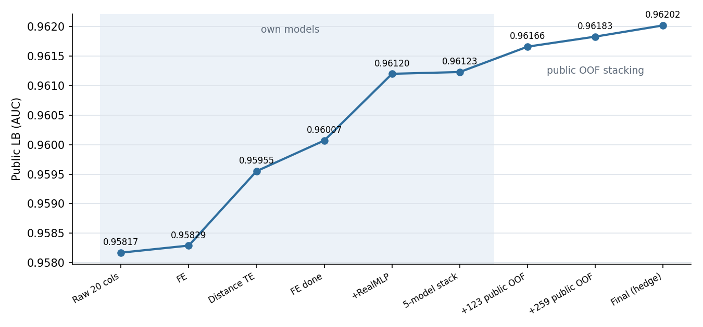
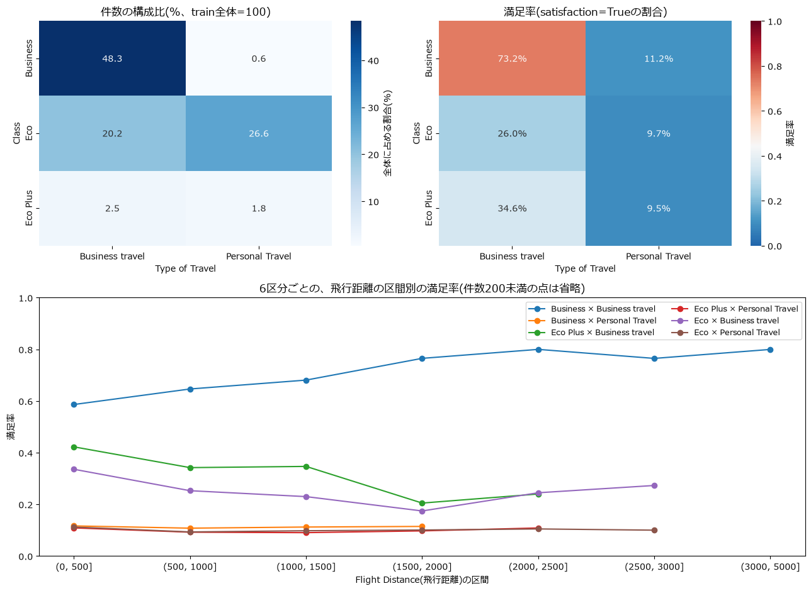
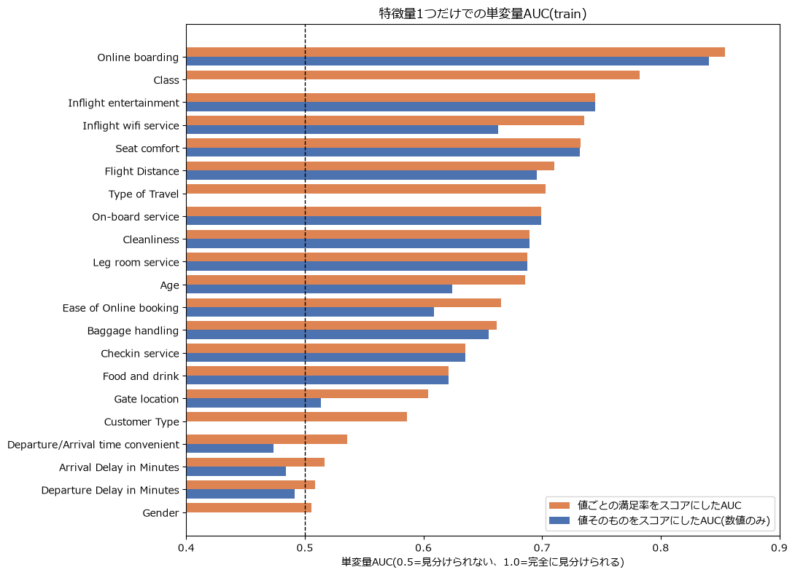
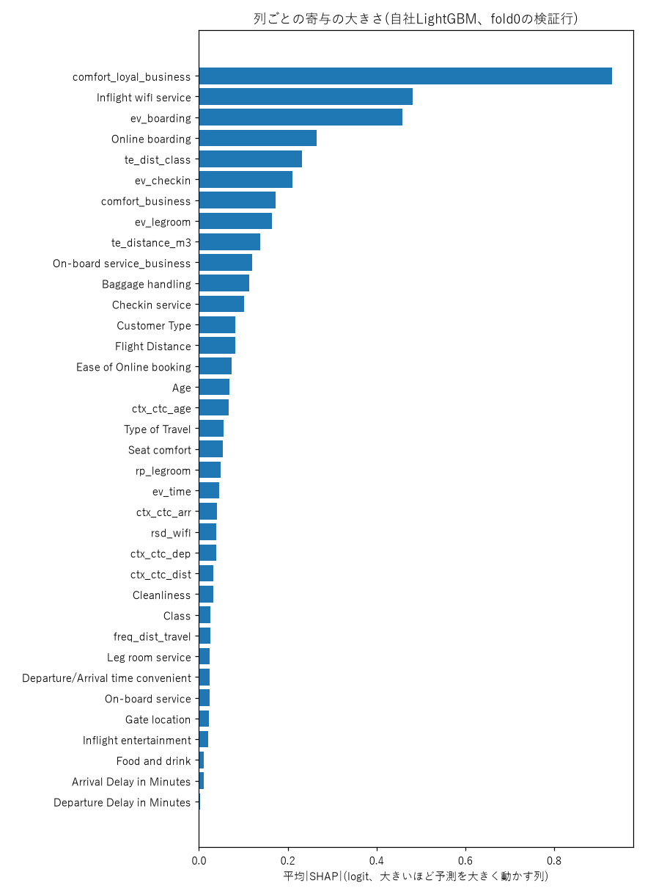

# Kaggle Playground S6E10 — Predicting Airline Satisfaction

Binary classification: predict whether an airline passenger is satisfied from a survey (age, class, travel type, flight distance, delays, and 14 service ratings scored 0–5). Metric: **ROC AUC**. Data: 699,635 training rows and 299,844 test rows of synthetic data generated from a real airline survey.

日本語版は [README.ja.md](README.ja.md) をご覧ください。

## Result

**Final: Private LB 0.96239, rank 52 / 3,748 teams (top 1.4%)**, reached by stacking other participants' published OOF predictions together with my own models. The Public rank was 513.

| Submission | Private LB | Public LB |
|---|---|---|
| **(1) Best stack by CV (226 predictions combined into one), selected** | **0.96239** | 0.96182 |
| (2) Hedge: (1) blended 1:1 with another participant's public LB–tuned submission file, selected | 0.96236 | 0.96202 |

- **What (1) is:** 226 predictions (five models I trained myself — LightGBM, XGBoost and CatBoost implemented by me, RealMLP and TabPFN reproduced from public notebooks — plus OOF predictions published by other participants) are combined into one prediction by a second-level model. The second level blends two models 80:20.
  - **Logistic regression (80%):** combines the 226 predictions as a weighted sum. Stable, but it can only add.
  - **Shallow LightGBM (20%):** can learn conditional rules such as "when these two predictions disagree, trust this one". The trees are kept shallow (15 leaves, at least 2,000 rows per leaf) and strongly regularized to avoid overfitting. The 80:20 ratio was taken from the public example as is, because re-selecting it on my own OOF would inflate the score.
  - Adding LightGBM improved OOF by only +0.000006, but it improved under all three fold splits, so it was kept.
  - **Why logistic regression is the main second-level model:**
    1. **Same as the top public examples:** all seven top public notebooks I surveyed used logistic regression on logit-transformed predictions as the second level.
    2. **Slightly better in a fair comparison:** I compared it with the other common method, a weighted rank average: convert each model's predictions to ranks, try every combination of model weights (e.g. 0.6:0.4) in steps of 0.1, and average with the best-scoring combination. With five models, logistic regression scored 0.961685 and the weighted rank average 0.961646 (+0.000039). Note that both methods choose their weights by looking at the answers, so scoring on the same data used to choose the weights inflates the score. I therefore split the training data (~700k records) into five groups and, for both logistic regression and the weighted rank average, chose the weights on four groups and scored on the remaining one.
    3. **It can set weights for many predictions:** a brute-force weight search like the weighted rank average has far too many combinations with 226 predictions, whereas logistic regression computes all 226 weights at once.
    4. **It keeps weights from becoming extreme when predictions are similar:** with many near-duplicate predictions, weights tend to take extreme values (a large positive weight on one and a large negative weight on another) and overfit the training data. L2 regularization (which keeps weights from growing too large) prevents this. Among seven strengths, C=0.003 was best; too strong (0.0003) also shrank the weights of strong models (−0.000072), and too weak (0.03) let the weights of similar predictions blow up (−0.000031).
    5. **Better than LightGBM alone:** LightGBM alone as the second level scored 0.96204, below logistic regression (0.96225), so LightGBM is used only as a 20% helper.
- **What (2) is:** another participant's submission file that had been tuned while watching the Public LB (Public 0.96213). It has no OOF, so it cannot be evaluated by CV. (1) and that file were each converted to prediction ranks (0–1) and averaged 0.5:0.5. The 0.5 was fixed in advance so as not to fit the Public LB. Because the final rank uses the better Private score of the two slots, I submitted one CV-trusting file (1) and one Public-LB-trusting file (2).

The submission chosen by cross-validation was my best Private score among all submissions. The hedge scored higher on the Public LB but lower on the Private LB. Many teams that had submitted public LB–tuned files dropped on the Private LB.



## Approach

| Phase | What I did | Main outcome (OOF AUC) |
|---|---|---|
| EDA | Univariate AUC per feature, cross tabs, the meaning of "0" ratings, per-segment heatmaps | Found that a rating's effect depends on the customer segment (e.g. comfort matters only for loyal business travelers) |
| Feature engineering | LightGBM, adding one feature at a time and judging over 3 CV seeds | Raw 20 columns 0.95846 → with engineered features 0.96046 (default parameters) |
| Models | LightGBM, XGBoost, CatBoost, RealMLP, TabPFN (RealMLP and TabPFN reproduced from public notebooks) | Single models 0.9608–0.9611 |
| Hyperparameters | Optuna (LightGBM, XGBoost, CatBoost on Kaggle GPU) | LightGBM +0.00039 alone, but only +0.00005 in the blend |
| Ensemble | Stacking with logistic regression on logits, evaluated on a separate fold split | 5-model stack 0.961685 |
| Public OOF | Added other participants' published OOF predictions as stack members; second level = 80% logistic regression + 20% shallow LightGBM | 226 members 0.962266 |

### What the EDA found

Full steps and plots are in [notebooks/EDA.ipynb](notebooks/EDA.ipynb) (8 sections, with outputs).

- **Only "business class on a business trip" is highly satisfied:** that combination is 73.2% satisfied, while personal travel is 9.5–11.2% in every class (11.2% even in business class). Top right of the figure below.
- **Most of the flight-distance effect was really a customer-segment effect:** overall, longer flights look more satisfied (univariate AUC 0.696, using the raw distance as the score), but within the six Class × Type of Travel segments the same measure drops to 0.44–0.59. For economy business travelers, satisfaction actually falls with distance (bottom of the figure).
- **How service ratings work depends on the segment:** ratings such as in-flight entertainment, seat comfort and cleanliness separate well for business travelers (AUC 0.72–0.79) but hardly at all for personal travelers (0.50–0.51). A gated feature built from this (ratings kept only for the segment where they matter) became the top feature by SHAP.
- **A rating of 0 is not always the worst rating:** passengers who rated in-flight Wi-Fi 0 were 88.7% satisfied, far above those who rated it 1 (39.1%). A 0 most likely means "not used / not applicable".





### What worked

| Idea | Gain (OOF AUC) | Why I think it worked |
|---|---|---|
| Target encoding of the exact Flight Distance value | +0.00136 | Only 3,474 distinct distances; each behaves like a route ID with its own satisfaction rate. Trees would need thousands of splits to learn this |
| "Gate" features: a rating kept only for the segment where it matters (others set to missing) | +0.00005 to +0.00009 each | From the EDA: comfort ratings predict satisfaction for business travelers (AUC 0.72–0.79) but not for personal travel (≈0.50). The top SHAP feature was one of these |
| Expected value of a rating predicted from the other 20 columns (no labels used) | +0.00004 to +0.00009 | A passenger who rates lower than expected is less satisfied |
| Route profile (mean rating per distance value) and segment deviations | +0.00004 to +0.00006 | Summaries a tree cannot build in one split |
| Adding diverse models (RealMLP, TabPFN) to tree models | +0.001 (LB) | Rank correlation with the trees was 0.96, compared with 0.98–0.99 between trees |
| Stacking with published OOF predictions | +0.00054 (LB +0.0006) | More model families (tabular foundation models, TabPFN variants) than I could train myself |



### What did not work (selected)

- Adding the original real dataset as extra training rows: −0.00017. Using a model trained on it as a single "teacher" feature helped OOF (+0.00038) but lowered the Public LB by about 0.0002, so I left it out.
- Digit features, GPT-2 token keys, and interaction products: no gain on top of target encoding.
- TabM (another neural net): its predictions differed the most from the others (rank correlation 0.94), but its single score was 0.0024 lower, so it got no weight. Being different is necessary but not sufficient.
- Dropping stack members with negative coefficients: −0.00015. A negative coefficient offsets similar members and does not mean the member is useless.

## Validation

- 5-fold StratifiedKFold (seed 42). Every comparison uses the same folds and rows.
- **Adopt a feature only if the mean gain over 3 CV seeds is at least +0.00003 and at least 2 of 3 seeds improve.** Changing only the fold seed moved the difference by about 0.00005, so a single-seed result was not trustworthy.
- Stacking was evaluated on a separate 5-fold split (seed 7): the blend is learned on 4 folds and scored on the remaining one.
- Public LB (about 60k rows) cannot distinguish differences below about 0.0003, so decisions were based on OOF (700k rows).

## My work vs. external resources

- **Implemented myself:** EDA, all feature engineering code, the 3-seed adoption framework, LightGBM/XGBoost/CatBoost pipelines and tuning, stacking and its evaluation. The code is in `src/` and `experiments/`.
- **Ideas taken from public notebooks and re-implemented in my own code:** original-data teacher, expected-value features, route profile, segment statistics, all-categorical CatBoost, and blending a shallow LightGBM into the second level (ewtherka).
- **Reproduced from public notebooks (code not included in this repository):** the RealMLP configuration (yekenot) and the TabPFN memory workaround (hemingweb).
- **Used as-is (not included):** published OOF predictions from about 20 Kaggle datasets (cdeotte and others) as stack members in the final submission.
- **Final submission:** slot 1 is the best stack by CV (Private 0.96239). Slot 2 is a hedge: slot 1 and another participant's public LB–tuned submission file, each converted to ranks and averaged 1:1 (Private 0.96236). Slot 2 has no CV backing and did slightly worse on the Private LB.

## Lessons

1. In synthetic data, check value-level patterns first. The exact-value target encoding was the largest single gain.
2. EDA findings such as segment-dependent effects translate directly into features.
3. For ensembles, add models that are both different and strong. Gains from hyperparameter tuning shrank to 1/5–1/10 once the models were blended.
4. At the top of the leaderboard, the gap came from the number and variety of models. Check early whether public OOF predictions exist.
5. Confirm small differences over several seeds and do not chase small Public LB differences. Here, trusting CV moved the final rank from 513 (Public) to 52 (Private).

## Repository layout

```
src/            lgb_fe_check.py (features + LightGBM + 3-seed check), aux_expected_value.py,
                xgb_check.py, catboost_kaggle.py (Kaggle GPU), stack_check.py (stacking evaluation)
experiments/    lgb_forward_add.py, lgb_optuna.py, shap_report.py
notebooks/      EDA.ipynb (with outputs)
docs/           review_ja.pdf (Japanese slide deck, 52 slides), img/
```

## Reproduce

```bash
uv sync
# put train.csv and test.csv from the competition page into data/
python src/lgb_fe_check.py --help          # each script's docstring explains its purpose and options
python src/aux_expected_value.py --col "Online boarding" --name boarding
```

Scripts are run from the repository root. Comments and docstrings are in Japanese.

## Development note

I carried out the analysis and implementation with the help of an AI coding assistant (Claude Code). I made the decisions on which experiments to run and which results to adopt, and recorded them in my own experiment log.
