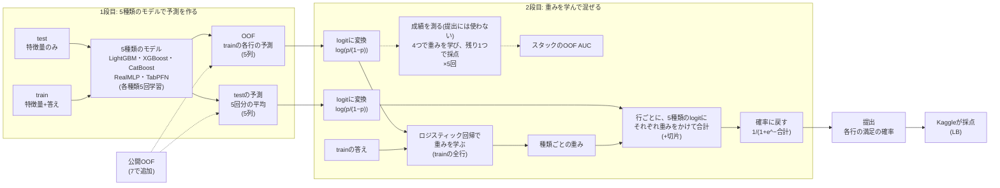

# Kaggle Playground S6E10 — 航空会社の乗客満足度予測

> **要約**
> - **何をしたか:** EDA → ベースライン → 特徴量エンジニアリング → モデル作成 → ハイパラ調整 → アンサンブル → 公開OOFの導入まで、各段階の採否を自分で判断した。
> - **結果:** 3,748チーム中52位(上位1.4%)。最終提出をCV(手元の検証スコア)で選び、Public 513位からPrivate 52位に上がった。
> - **強み:** ブレを測ってから採用基準を決め、対照実験で原因を切り分ける。判断ミスや甘かった基準も記録した。

乗客アンケート(年齢・座席クラス・旅行目的・飛行距離・遅延・サービス評価14項目)から、「満足」と答えたかを当てる二値分類。評価指標は**AUC**。人工データで、train 699,635行・test 299,844行。

## 結果

**Private LB 0.96239、52位 / 3,748チーム(上位1.4%)。**

| 提出 | Private LB | Public LB |
|---|---|---|
| **① CVで最良のスタック(226本の予測をまとめたもの)** | **0.96239** | 0.96182 |
| ② 保険: ①と、公開LBに合わせた他の参加者の提出ファイルを1:1で混ぜたもの | 0.96236 | 0.96202 |

### 段階ごとのスコア

| 段階 | Private LB | 相当する順位 |
|---|---|---|
| ベースライン(LightGBM、生の20列) | 0.95910 | 約2,860位(上位76%) |
| + 特徴量エンジニアリング | 0.96102 | 約1,760位(上位47%) |
| + 仕組みの違うモデル(RealMLP)と混ぜる | 0.96192 | 約1,170位(上位31%) |
| + 自分の5モデルのスタッキング | 0.96208 | 約1,090位(上位29%) |
| + 公開OOFの導入(最終) | **0.96239** | **52位(上位1.4%)** |

上位29%から1.4%までの差(+0.00031)は、公開OOFの導入によるものです。

### 上位1.4%に届いた理由

1. **EDAの発見を特徴量にした:** 「評価の効き方は客層で変わる」などの発見から、LightGBMを0.95846→0.96046に上げた(→[1](#1-eda)・[3](#3-特徴量エンジニアリング))。
2. **ブレを測ってから採否基準を決めた:** 分け方を変えるだけで差が約0.00005揺れるので、3通りの分け方で判定した(→[検証の仕方](#検証の仕方))。
3. **調整より、仕組みの違うモデルに時間を使った:** 調整の伸びは混ぜると大きく縮んだ。木と仕組みの違うTabPFNを足す方が伸びた(→[5](#5-ハイパラ調整)・[6](#6-アンサンブル))。
4. **公開OOFを点検してから導入した:** 上位との差は「混ぜるモデルの数と種類」と分かり、点検した公開OOFを導入した(OOF+0.00038、LB+0.00043)(→[7](#7-公開oofの導入))。
5. **最終提出をCVで選んだ:** Public LB(約6万行)は0.0003未満の差を見分けられない。CVで選んだ①がPrivateで最高点だった。

## 取り組みの流れ

コードは`src/`の下に、段階と同じ番号のフォルダで置いています。

| 段階 | やったこと | 主な結果(OOF AUC) | コード |
|---|---|---|---|
| [1. EDA](#1-eda) | 単変量AUC、クロス集計、評価「0点」の意味、客層ごとのヒートマップ | 評価の効き方が客層で変わる | `src/1_eda/` |
| [2. ベースライン](#2-ベースライン) | 生の列を強い順に1つずつ足し、土台の列を決める | 生の20列で0.95846 | `src/2_baseline/` |
| [3. 特徴量エンジニアリング](#3-特徴量エンジニアリング) | 候補を1つずつ足し、3通りの分け方で判定 | 0.96046 | `src/3_feature_engineering/` |
| [4. モデル作成](#4-モデル作成) | 木3種類+RealMLP・TabPFN | 単体 0.9608〜0.9611 | `src/4_models/` |
| [5. ハイパラ調整](#5-ハイパラ調整) | Optunaで3モデルを調整 | 単体は伸びたが、混ぜると伸びが約1/4〜1/50に縮んだ | `src/5_tuning/` |
| [6. アンサンブル](#6-アンサンブル) | 5モデルのスタッキング | 0.961685 | `src/6_ensemble/` |
| [7. 公開OOFの導入](#7-公開oofの導入) | 点検した公開OOFを6のスタックに追加 | 226本で0.962266 | `src/6_ensemble/`で評価 |

## 1. EDA

**コード:** [src/1_eda/EDA.ipynb](src/1_eda/EDA.ipynb)(グラフと節ごとの考察はノートブックにあります)

| 発見 | そこから試したこと | ノートブック |
|---|---|---|
| 満足率が高いのは「出張でビジネスクラス」(73.2%)だけ。飛行距離の効き目の多くは客層の違い(全体のAUC 0.696が、客層6区分の中では0.44〜0.59) | 距離の値ごとの満足率(Target Encoding)が最大の改善(+0.00136) | 5節 |
| サービス評価の効き方は客層で変わる(出張客はAUC 0.72〜0.79、私用客は0.50〜0.51) | 効く客層だけ評価の値を持つ「ゲート特徴量」(+0.00021、SHAPで1位) | 8節 |
| 評価「0点」は「評価なし」の場合がある(Wi-Fiの満足率は0点89%、1点39%) | 0点フラグは不採用(木が1回の分岐で区別できていた)。「0点の個数」は採用 | 7節 |
| 値と満足率の関係がまっすぐでない特徴量がある(年齢は山型、Wi-FiはU字型) | 値ごとの満足率で測る単変量AUCで、特徴量の強さを比べた | 1・2・6節 |

## 2. ベースライン

**コード:** `src/2_baseline/lgb_forward_add.py`

- 生の列21個を、単変量AUCの高い順にLightGBMへ1つずつ足し、OOFの伸びを測った。
- 20列目まではすべて改善。単独では弱い顧客区分(AUC 0.586)も+0.00113と、組み合わせで効いた。
- 性別だけは−0.00002だったので外し、**20列を土台**にした(OOF 0.95846)。以降の特徴量はこの土台に足して判定した。

## 3. 特徴量エンジニアリング

**コード:** `src/3_feature_engineering/`

| スクリプト | 役割 |
|---|---|
| `features.py` | 特徴量の定義(候補・採用した一覧・Target Encoding)。全モデルがここから読み込む |
| `make_expected_value.py` | 「他の列から予想した評価の期待値」を前もって計算して保存する(重いので判定のたびには計算しない) |
| `shap_report.py` | 採用した特徴量の効き方をSHAPで確かめる |

候補は1つずつ、土台と「土台+候補」をLightGBM(`src/4_models/lgb_check.py --fe 候補名`)で比べ、[検証の仕方](#検証の仕方)の基準で採否を決めた。

**効いたもの**

| 特徴量 | なぜ試したか | 改善幅 | なぜ効いたか |
|---|---|---|---|
| 飛行距離の値ごとの満足率(Target Encoding) | 値ごとの満足率の単変量AUC(0.741)が、生の値(0.696)より高かった | +0.00136 | 距離の値が路線IDのように満足率のクセを持つ。LBでも+0.00122 |
| ゲート特徴量 | EDAの発見(8節) | 各+0.00005〜+0.00009 | 私用客の評価はノイズなので、効く客層だけに値を持たせた |
| 評価の期待値 | 公開ノートブックのアイデア | 4項目で各+0.00004〜+0.00009 | 期待値より低めに付けた人ほど満足していない(93%→30%) |
| 路線ごとの評価の平均 | Discussionのアイデア | 足元の広さだけ+0.000061 | 木が1回の分岐では作れない要約 |
| 客層グループ内の偏差 | 公開ノートブック(48列)を4列に絞った | +0.0000375 | 同上 |

**効かなかったもの**

- 元の実データを学習の行として足す: −0.00017。
- 数値の桁、GPT-2のトークン区切り、掛け算の交互作用: 伸びなかった。
- **(例外)外したが効いていた「先生役」:** 元データで学習したモデルの予測を特徴量にする方法。OOFで+0.00038だったが、Public LBの−0.00020を見て外した。Privateでは+0.00025で、誤りだった。

## 4. モデル作成

**コード:** `src/4_models/`

| スクリプト | 役割 |
|---|---|
| `lgb_check.py` | LightGBMの学習と、特徴量の採否の判定(3で使用)。最終のLightGBMもこれ |
| `xgb_check.py` | XGBoostを同じ特徴量で学習し、混ぜる価値を診断する |
| `catboost_kaggle.py` | CatBoostを学習する(KaggleのGPU) |

- 木3種類は自分で実装。RealMLP・TabPFNは公開ノートブックの再現なので、コードは含めていない。
- **CatBoostの全列カテゴリ化:** 公開ノートブックの「全列カテゴリ化+TEなし」(+0.00015の報告)を2つに分けて試した。全列カテゴリ化が+0.000187、TEを外すのは±0だったので、前者だけ採用した。
- **効かなかったもの:** TabM(ニューラルネット)は最も違う予測(順位相関0.94)だったが、単体が0.0024低く、混ぜても重みが付かなかった。

## 5. ハイパラ調整

**コード:** `src/5_tuning/`(Optunaで複数のハイパラを同時に探索。最良の設定は3通りの分け方で調整前と比べてから採用)

| スクリプト | 探索 | 単体の伸び | 混ぜたときの伸び |
|---|---|---|---|
| `lgb_optuna.py` | LightGBM、50試行 | +0.00041 | +0.000046 |
| `xgb_optuna.py` | XGBoost、50試行 | +0.000244 | +0.000005 |
| `catboost_optuna.py` | CatBoost、KaggleのGPU、30試行 | +0.000076 | +0.000020 |

- **3モデルとも、混ぜると伸びが約1/4〜1/50に縮んだ。** 調整後のモデルが混ぜ相手に似て(例: LightGBMとRealMLPの相関0.962→0.970)、伸びた分が重なった。
- 木どうしの相関も0.980〜0.992と高い。**そこで、調整より仕組みの違うモデルを増やす方に時間を使った**(→[6](#6-アンサンブル))。

## 6. アンサンブル

**コード:** `src/6_ensemble/stack_check.py`

**目的:** 仕組みの違う強いモデルを混ぜて、得意・不得意を補い合い、AUCを上げる。



### 1段目: 仕組みの違う5種類のモデルで予測を作る

各種類をtrainの5分割で5回学習する(分け方は5種類とも同じ)。OOFは、各行を「その行を学習していないモデル」で予測したもの。testには答えがないので、手元の成績はOOFで測る。

### 2段目: 重みを学んで混ぜる(スタッキング)

OOFのlogitから、trainの答えに一番合う重みと切片(全行に同じだけ足す定数)をロジスティック回帰で学ぶ。重みの合計は1ではなく、平均とは違う。ロジスティック回帰を選んだ理由は、上位の公開ノートブック7本と同じ形で、順位の重み付き平均より+0.000039高く、本数が増えても正則化で重みの偏りを抑えられるため。

### 公平に測る

重みを決めた行で採点すると点数が甘くなるので、成績は「4つで重みを学び、残り1つで採点」を5回くり返して出した(1段目とは別の分け方)。提出用は全行で学び直した。

### 結果

- **OOF 0.961685**。伸びの多くはTabPFN(木との順位相関0.961〜0.965と低く、加えると+0.000140、5foldすべてで改善)。
- 係数はTabPFN 0.42、RealMLP 0.35、CatBoost 0.13、LightGBM・XGBoost 各0.05。仕組みの違うモデルほど重く使われた。
- 効かなかったもの: 係数がマイナスのメンバーを外すと−0.00015。似たメンバーとの差し引き役だった。

## 7. 公開OOFの導入

**目的:** 6のスタックに、自分では作れない種類のモデルを加え、モデルの数と種類を増やす。上位の公開ノートブックの調査で、上位との差は「混ぜるモデルの数と種類」から来ていると分かったため。

### 公開OOFとは

他の参加者が公開した、OOFとtestの予測のセット。**予測の値だけ**なので、中のモデルの数や分け方は公開した人しだい。それでも、OOFが「その行を学習していないモデルの予測」になっていれば、2段目からは**列が1本増えるだけ**で、6の仕組みにそのまま入れられる。コードは他の参加者の成果物なので含めていない。

### 導入の手順

1. **点検する(124本):** 行数・欠損・範囲外の値と、予測値の平均(OOFもtestも満足率の約0.44になるはず)を確かめた。平均がちょうど0.5(順位に直してある印)で、単体のAUCが自分のスタックより高い1本は、すでに他のモデルを混ぜたものとみて外した。
2. **6の2段目に加えて測る:** 123本を加えると、OOF +0.00038、LB +0.00043。答えが漏れた甘いOOFが混ざっていれば「OOFだけ伸びてLBは伸びない」はずだが、そのサインはなかった。
3. **混ぜ方を1つずつ調整する(本数が増えたため):**

| 施策 | 結果 | 判断 |
|---|---|---|
| 正則化の強さ(7通り) | C=0.003が最良 | 採用 |
| LightGBM系統49本を外す | +0.000014(ランダムに外すと悪化) | 採用 |
| 2段目に浅いLightGBMを2割混ぜる | +0.000006(3seedとも改善)。LightGBMだけを2段目にすると0.96204で、ロジスティック回帰(0.96225)より低いので補助にした | 採用 |
| 似たメンバーの間引き | ±0〜−0.000127 | 不採用 |

4. **新しい公開OOFは1本ずつ足す:** 3通りの分け方で判定し、改善したものだけ加えて**226本、OOF 0.962266**(Private 0.96239)。
5. **LBに合わせた提出ファイルは本命に混ぜない:** OOFが無くCVで測れないので、保険の②だけに使った。

## 検証の仕方

- 5分割のStratifiedKFold(seed 42)。比較は常に同じ行で行う。
- **採否基準:** 3通りの分け方で差の平均が+0.00003以上、かつ2つ以上で改善。分け方を変えるだけで差が約0.00005揺れたので、3通りの平均のブレ(≈0.00003)を超えたものを採用した。
- **反省:** この基準は緩く、効果ゼロでも約16%が通る。すれすれで採用した5つは、まとめると効いていなかった。次からはブレ2つ分に厳しくした。
- 判断はOOF(70万行)で行い、Public LB(約6万行)の小さな差は追わなかった。終了後、提出どうしの差の向きがPrivateと一致した割合は、OOFで98%、Public LBで92%だった。

## 自分の工夫と外部の活用の区別

- **自分で実装:** EDA、特徴量エンジニアリング、3通りの分け方での判定、木3種類の学習と調整、スタッキングとその評価。このリポジトリのコードはすべて自分で書いたもの。
- **公開ノートブックのアイデアを自分で実装し直したもの:** 先生役、期待値、路線プロファイル、客層グループの統計、CatBoostの全列カテゴリ化、2段目の浅いLightGBM(ewtherka氏)。
- **公開ノートブックの再現(コードは含めない):** RealMLP(yekenot氏)、TabPFNのメモリ節約(hemingweb氏)。
- **そのまま使ったもの(含めない):** 公開OOF(cdeotte氏ほか、約20のデータセット)。

## 学んだこと

1. 人工データでは、まず値ごとのクセを疑う(値ごとのTarget Encodingが最大の改善)。
2. EDAの発見は、そのまま特徴量になる。
3. アンサンブルには「違う」かつ「強い」モデルを足す。調整の伸びは、混ぜると大きく縮む。
4. 上位との差は、モデルの数と種類から来ていた。公開OOFは早めに調べ、点検してから使う。
5. Public LBの小さな差は追わない。CVを信じてPublic 513位→Private 52位。逆に、Public LBで外した先生役はPrivateでは効いていた。
6. 採否基準は、偶然の採用がどのくらい起きるかを計算して決める。

## フォルダ構成

```
src/
  1_eda/                   EDA.ipynb
  2_baseline/              lgb_forward_add.py
  3_feature_engineering/   features.py、make_expected_value.py、shap_report.py
  4_models/                lgb_check.py、xgb_check.py、catboost_kaggle.py
  5_tuning/                lgb_optuna.py、xgb_optuna.py、catboost_optuna.py
  6_ensemble/              stack_check.py
```

## 再現手順

```bash
uv sync
# コンペのページからtrain.csvとtest.csvをdata/に置く。スクリプトはリポジトリのルートで実行する
# 1. 評価の期待値を前もって計算する(採用した4項目)
python src/3_feature_engineering/make_expected_value.py --col "Online boarding" --name boarding
python src/3_feature_engineering/make_expected_value.py --col "Leg room service" --name legroom
python src/3_feature_engineering/make_expected_value.py --col "Checkin service" --name checkin
python src/3_feature_engineering/make_expected_value.py --col "Departure/Arrival time convenient" --name time
# 2. LightGBM(採用した特徴量で学習。--helpで各オプションの説明)
python src/4_models/lgb_check.py --fe none
# 3. CatBoostの入力(data/fe36_*.csv)を書き出す
python src/4_models/lgb_check.py --fe none --export-fe
```

## 開発について

分析と実装は、AIコーディングアシスタント(Claude Code)を使って進めました。どの実験をするか、どの結果を採用するかは自分で判断し、実験記録に残しています。
