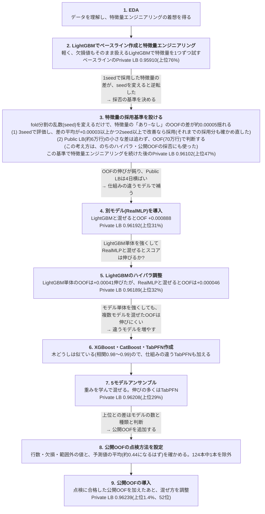
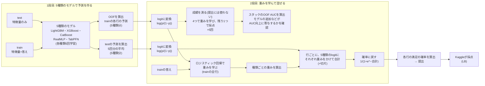
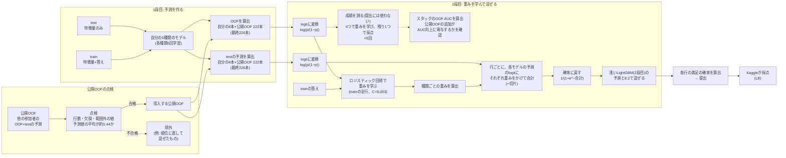

# Kaggle Playground S6E10 — 航空会社の乗客満足度予測

## コンペ概要

| 項目 | 内容 |
|---|---|
| コンペ | Kaggle Playground Series S6E10「Predicting Airline Satisfaction」(2026年10月開催) |
| 課題 | 乗客アンケート(年齢・座席クラス・旅行目的・飛行距離・遅延・サービス評価13項目)から、「満足」と答えたかを当てる二値分類 |
| データ | 人工データ。train 699,635行・test 299,844行。満足の割合は約44%(偏りの小さい2クラス) |
| 評価指標 | **AUC**(満足の客を不満の客より上位に並べられたか。1に近いほど良い) |
| 参加 | 3,748チーム。個人で参加 |

## 結果

**Private LB 0.96239、52位 / 3,748チーム(上位1.4%)。**

## 取り組みの流れ

段階ごとの詳細は下の各節([1](#1-eda)〜[9](#9-公開oofの導入))に書いた。コードは`src/`の下に、段階と同じ番号のフォルダで置いている(3・4はコードなし)。



## 上位1.4%に届いた考察

1. **ブレを測ってから採否基準を決めた:** 特徴量で決めた「分け方を3通り変えて判定する」考え方を、のちのハイパラや公開OOFの採否にも使い、偶然の改善を採用しないようにした(→[3](#3-特徴量の採用基準を設ける))。
2. **単体モデルの強化より、仕組みの違うモデルの導入に時間を使った:** 5モデルのスタックで重く使われたのは、木と仕組みの違うTabPFN(係数0.42)とRealMLP(0.35)だった(→[5](#5-lightgbmのハイパラ調整)・[7](#7-5モデルアンサンブル))。
3. **公開OOFを点検してから導入した:** 加えたときOOF(+0.00038)とPublic LB(+0.00043)が同じくらい伸び、甘いOOFによる崩れはなかった(→[8](#8-公開oofの点検方法を設定)・[9](#9-公開oofの導入))。
4. **最終提出をCVで選んだ:** Public LB(約6万行)は0.0003未満の差を見分けられない。CVで選んだ提出(Public LB 513位)が、Private LBでは52位になった。

## 1. EDA

EDAでは3つの仮説を確かめ、2つを特徴量にした。

**① 飛行距離の効き目は客層の違いか**
- **仮説:** 飛行距離が長いほど満足率が高い(1,500付近を境に約30%から66〜77%へ上がる)。しかし、「出張かつビジネスクラス」の客層は飛行距離が長い傾向にあり、その結果として長距離の満足率が高く見えているのではないか。
- **結果:** 仮説どおりだった。飛行距離の中央値は、出張かつビジネスクラスが1,747、ほかの5区分は719〜821で、1,500以上の乗客の88%が出張かつビジネスクラスだった。満足率も、出張かつビジネスクラスは73.2%、私用旅行は座席クラスに関係なく9.5〜11.2%だった。座席クラス×旅行目的の6区分の中で見ると、飛行距離だけで満足を見分ける力(単変量AUC)は0.696から0.44〜0.59に下がった。
- **思いついた特徴量:** 私用客はサービス評価の点数に関係なく満足率が約10%だったので、評価が満足に効くのは出張客だけと考えた。そこで、出張客だけにサービス評価の値を持たせ、ほかは空欄にするゲート特徴量(出張客の快適さ・出張客の機内サービス)を作った(採用、+0.000063・+0.000045)。また、飛行距離の効き方は座席クラスで違うので、飛行距離×座席クラスごとの満足率を作った(採用、+0.000060)。

**② サービス評価の0点は「評価なし」か**
- **仮説:** Wi-Fiとオンライン予約は、点数と満足率の関係がU字型だった(Wi-Fiの満足率は0点89%、1点39%、2〜3点27%、5点95%)。0点は最低評価ではなく、そのサービスを使っていない「評価なし」ではないか。
- **結果:** 項目によって違った。Wi-Fi・オンライン予約・オンライン搭乗は、0点の満足率(89%・71%・62%)が1点(39%・42%・11%)よりずっと高く、「評価なし」と考えられる。一方、座席・食事などは0点と1点の満足率がほぼ同じで、0点は最低評価として使われていた。
- **試した特徴量と結果:** 項目ごとに「0点かどうか」の印を作ったが、効かなかった。決定木は「評価が0.5以下」という1回の分岐で0点の人を切り出せるので、印は新しい情報にならなかった(0点の人の満足率は、印がなくても予測と実際の差が±0.005で見積もれていた)。複数の項目にまたがる「0点の個数」は1回の分岐では作れないので試したが、1seedで+0.00001、3seedで確かめ直すと採用基準に届かず外した。

**③ 客層によってサービス評価の効き方が変わるか**
- **仮説:** ①から作ったゲート特徴量(出張客だけにサービス評価の値を持たせる)が効いた。旅行目的だけでなく、座席クラスや常連かどうかでも、サービス評価の効き方が変わるのではないか。
- **結果:** 変わった。出張客は機内エンタメ・座席などのサービス評価が4〜5点で満足率70〜85%に上がるが、私用客は点数に関係なく約10%だった(単変量AUC 0.72〜0.79 対 0.50〜0.51)。常連でない客(ほぼ全員が出張客)では、快適さの評価はどの点数でも満足率が約20%で効かず、逆にWi-Fi・オンライン予約が強く効いた。
- **思いついた特徴量:** 快適さ(座席・足元の広さ・機内エンタメの点数の平均)を、常連かつ出張客だけに持たせ、ほかは空欄にするゲート特徴量を作った(採用、+0.000070)。SHAP(予測への寄与)で1位になった。

各節のグラフと集計は、ノートブックの5節(①)・7節(②)・8節(③)にある。

**コード:** [src/1_exploratory_data_analysis/EDA.ipynb](src/1_exploratory_data_analysis/EDA.ipynb)

## 2. LightGBMでベースライン作成と特徴量エンジニアリング

**元の特徴量(コンペで最初から与えられた21個)**

| 種類 | 特徴量 |
|---|---|
| 乗客 | 性別、年齢、顧客区分(常連 / 常連でない) |
| 旅行 | 旅行目的(出張 / 私用)、座席クラス(ビジネス / エコノミー / エコノミープラス)、飛行距離 |
| 遅延 | 出発遅延(分)、到着遅延(分、一部欠損) |
| サービス評価(13項目、0〜5点) | Wi-Fi(機内)、時刻の便利さ(出発・到着)、オンライン予約(しやすさ)、ゲートの場所、食事、オンライン搭乗、座席(快適さ)、機内エンタメ、機内サービス、足元の広さ、手荷物の扱い、チェックイン、清潔さ |

### (1) ベースライン

`select_baseline_features.py`で、元の特徴量から土台を決めた。

- 元の特徴量21個を、単変量AUCの高い順にLightGBMへ1つずつ足し、OOFの伸びを測った。
- 20個目まではすべて改善。単独では弱い顧客区分(AUC 0.586)も+0.00113と、組み合わせで効いた。
- 性別だけは−0.00002だったので外し、**20個を土台**にした(OOF 0.95846)。以降の特徴量はこの土台に足して判定した。
- ベースラインの判定は、採用基準([3](#3-特徴量の採用基準を設ける))を設ける前だったので、いずれもseed 42の1回だけで行った。性別は、のちに特徴量を29個に増やした土台でも試し直したが、−0.000053で効かなかった(これも1seed)。

**コード:** [src/2_lightgbm_baseline_and_feature_engineering/select_baseline_features.py](src/2_lightgbm_baseline_and_feature_engineering/select_baseline_features.py)

### (2) 特徴量エンジニアリング

候補は1つずつ、土台と「土台+候補」をLightGBM(`train_lightgbm.py --feature 候補名`)で比べた。最初の2日は1seedで「OOFが上がれば採用」としていたが、途中で[3. 特徴量の採用基準](#3-特徴量の採用基準を設ける)を設け、それまでに採用した分も3seedで確かめ直した。

**採用した特徴量**(元の特徴量20個+作った特徴量16個=36個。OOF 0.95846→0.96046)。作り方で3つに分け、各特徴量は「着想の根拠・導入理由・作った特徴量・改善幅・改善した考察」の順に書き、着想の出どころ(EDA・事前確認・過去のコンペの経験・公開ノートブック・Discussion等)は「着想の根拠」の先頭に書いた。事前確認は、特徴量を作って学習する前に、その値と満足率の関係を集計だけで確かめたもの(学習より速く、効きそうな候補を選べる)。改善幅は、注記のないものは3seed平均。

**① 条件で絞る(ゲート特徴量、3個):** 点数が効く客層だけに値を持たせ、他は空欄にする。

- **出張客の快適さ(ゲート特徴量)**
  - 着想の根拠: EDA: 私用客は座席クラス・飛行距離に関係なく満足率が約10%で、快適さの点数で満足率が変わるのは出張客だけだった(EDAノートブック5節、特徴量ノートブック1)
  - 導入理由: 私用客の快適さの点数は満足と関係しない。私用客を空欄にして、点数が効く出張客の値だけを渡せば、木が出張客の快適さに絞って分岐を作れると考えた
  - 作った特徴量: 快適さ(座席・足元の広さ・機内エンタメの点数の平均)を、出張客だけに持たせ、私用客は空欄にする
  - 改善幅: +0.000063
  - 改善した考察: ゲートなしの同じ平均(全員が値を持つ)は効かず(1seedで−0.00016)、ゲートありと直接比べるとゲートありが+0.00021だった。効果は平均を作ったことではなく、私用客を空欄にしたことによる。一方、サービス評価1項目の点数だけを出張客に持たせるゲート特徴量(例: 出張客の清潔さ)は、機内サービス以外効かなかった(下の出張客の機内サービス)。3項目の平均とゲートを1つにまとめた形が、木が自力で作りにくい区別になった可能性がある
- **常連かつ出張客の快適さ(ゲート特徴量)**
  - 着想の根拠: EDA: 常連でない客(ほぼ全員が出張客)では、快適さはどの点数でも満足率約20%で効かない(EDAノートブック8節)
  - 導入理由: 出張客の快適さには、快適さが効かない常連でない客も含まれる。効く客層(常連かつ出張客)だけに絞れば、快適さの効き方をより正確に渡せると考えた
  - 作った特徴量: 快適さを、常連の出張客だけに持たせ、それ以外は空欄にする
  - 改善幅: +0.000070(SHAPで1位)
  - 改善した考察: 出張客の快適さと置き換えたときは効かなかった(1seedで−0.00001)。入れる前のモデルも、常連でない出張客には快適さが効かないことを、顧客区分で分岐して予測できていた(点数別の予測と実際の満足率の差は−0.004〜+0.001)。出張客の快適さを残したまま足すと効いたので、木が常連と常連でない出張客の快適さを分けて使えるようになったことが効いた可能性がある
- **出張客の機内サービス(ゲート特徴量)**
  - 着想の根拠: EDA: 機内サービスの単変量AUCが出張客0.759、私用客0.509(EDAノートブック5・8節)
  - 導入理由: 出張客の快適さと同じく、効かない私用客の点数を空欄にすれば、出張客の点数の効き方だけを渡せると考えた
  - 作った特徴量: 機内サービスの点数を、出張客だけに持たせ、私用客は空欄にする
  - 改善幅: +0.000045
  - 改善した考察: サービス評価1項目の点数だけを出張客に持たせるゲート特徴量は、9項目(機内サービス・清潔さ・手荷物の扱い・チェックイン・機内エンタメ・座席・足元の広さ・食事・オンライン搭乗)で試し、効いたのは機内サービスだけだった。ほかの項目は、木が旅行目的とその項目の2回の分岐で同じ区別を作れるので、新しい情報にならなかったと考えられる。機内サービスだけが効いた理由は特定できていない(出張客と私用客の単変量AUCの差は、清潔さ0.732対0.502、機内エンタメ0.787対0.501と、ほかの項目も同じくらい大きかった)

**② 似た乗客で数える・平均する(9個):** 満足率(Target Encoding)は答えを使うので、自分を除いた乗客で数え、人数が少ない値は全体の満足率に寄せた(極端な値を防ぐ)。

- **飛行距離の値ごとの満足率**
  - 着想の根拠: 事前確認: 飛行距離の値は3,474種類あり、値ごとの満足率の単変量AUC(0.741)が、飛行距離そのもの(0.696)より高かった
  - 導入理由: 飛行距離は「長いほど満足」というまっすぐな関係ではなく、同じ距離(=同じ路線)ごとに満足率のクセがあると考えた。木が元の飛行距離から値1つ1つのクセを作るには数千回の分岐が必要なので、値ごとの満足率を1つの特徴量にまとめて渡せば使えると考えた
  - 作った特徴量: 同じ飛行距離の乗客のうち、満足した人の割合(Target Encoding。例: この路線の満足率)。強さm=3。mは、人数が少ない値の満足率を、全体の満足率にどれだけ寄せるかを決める値で、大きいほど強く寄せる。m=1・3・5・10・20・50を比べ、最も良かったm=3を使った
  - 改善幅: +0.00136(1seed。特徴量エンジニアリングで最大の改善。Public LBは+0.00126)
  - 改善した考察: 5foldすべてで改善した(各fold +0.0011〜+0.0015)。学習側のAUCはほぼ変わらず(0.9653→0.9655)、検証側だけが上がったので、答えの混入による見かけの改善ではないと考えられる。値ごとのクセの原因は特定できていないが、このコンペのデータの元になった公開データの、路線ごとの満足率が残っている可能性がある
- **飛行距離×座席クラスの満足率**
  - 着想の根拠: EDA: 飛行距離の効き方は客層で違う(EDAノートブック5節)
  - 導入理由: 同じ路線でもビジネス席とエコノミー席では満足率が違うので、路線ごとの満足率を座席クラスで分ければ、より細かいクセを渡せると考えた
  - 作った特徴量: 同じ距離で同じ座席クラスの乗客のうち、満足した人の割合(例: この路線のビジネス席の満足率)
  - 改善幅: +0.000060
  - 改善した考察: 単変量AUCは、飛行距離だけの満足率の0.743から0.839に上がった(特徴量ノートブック5)。それでも改善幅は、飛行距離だけの満足率(+0.00136)よりずっと小さい。入れる前のモデルの外れ(実際−予測)との相関も0.0056で、飛行距離だけの満足率を入れる前(0.026)の5分の1以下だった。座席クラスによる違いの多くは、飛行距離の満足率と座席クラスの元の特徴量から、木がすでに作れていたと考えられる
- **飛行距離×旅行目的の出現回数**
  - 着想の根拠: 過去のコンペの経験: 2つ前のコンペ(Predicting Smartphone Addiction、今回と同じく元データをもとに人工的に作られたデータ)では、数値の値がtrain+testに何回出てくるか(出現回数)を足すとAUCが0.96687から0.96760に上がった
  - 導入理由: 人工データでは、値の出現しやすさが、データを作る仕組みのクセを表すと考えた。今回も事前確認で、飛行距離が珍しい値の乗客の満足率は69%、よくある値の乗客は34%と、回数で満足率が大きく違った。ただし前のコンペ(Predicting Electric Vehicle Purchases)では出現回数を足しても効かなかったので、候補を13個作り1つずつ試した
  - 作った特徴量: 同じ距離で同じ旅行目的の乗客が、train+testに何人いるか(例: この路線の出張客の人数)
  - 改善幅: +0.000057
  - 改善した考察: 13個(1つの特徴量: 飛行距離・年齢・出発遅延・到着遅延・オンライン搭乗、組み合わせ: 飛行距離×座席クラス・飛行距離×旅行目的・飛行距離×顧客区分・年齢×飛行距離・年齢×座席クラス×旅行目的・飛行距離×座席クラス×旅行目的・飛行距離×旅行目的×顧客区分・サービス評価13項目)のうち、効いたのは飛行距離×旅行目的の出現回数だけだった。ほかは悪化か、採用基準に届かなかった。出張客は、同じ路線・同じ目的の乗客が少ない(190人以下)ほど満足率が高く(70.5%)、多い(2,340人超)と50.3%に下がった。私用客は8.9〜11.2%でほぼ横ばいだった(特徴量ノートブック6)。事前確認では、回数による満足率の違いは入れる前のモデルもすでに予測できていて、効かないと予想していた。それでも効いたので、人数そのものではなく、ほかの特徴量と組み合わせた分岐で効いたと考えられる。効果は小さく、seedを変えると+0.000107・−0.000026・+0.000090と揺れた(3の節)
- **足元の広さの路線平均**
  - 着想の根拠: Discussion・公開ノートブック: 飛行距離の値を路線IDとみなし、路線ごとに集計する見方が共有されていた(公開ノートブックでは路線ごとの集計で+0.00013〜+0.00124の報告)
  - 導入理由: 同じ路線には同じ機材(座席の間隔)・似た客層の乗客が集まるので、路線の乗客のサービス評価の平均は、1人の評価からは分からない「その路線の傾向」を表し、満足の予測に役立つと考えた
  - 作った特徴量: 同じ飛行距離(=同じ路線とみなす)の乗客の、足元の広さの点数の平均(例: この路線の足元の広さの評判)
  - 改善幅: +0.000061
  - 改善した考察: 200人以上が乗る783路線で、路線ごとのサービス評価の平均の違いは、偶然で生じる大きさの約6〜7倍あり、路線ごとに乗客の顔ぶれが本当に違っていた。足元の広さの路線平均が上位20%の路線は満足率80.2%、下位60%の路線は28.4〜31.6%だった(特徴量ノートブック7)。サービス評価13項目と年齢・遅延の路線平均(16個)を1つずつ試し、効いたのは足元の広さだけだった。路線平均どうしは似ていて(足元の広さと機内サービスの順位相関0.91など)、1つ入れると残りは新しい情報になりにくかった。ただし、路線ごとに違う値を持つ特徴量なら何でも「路線を区別する目印」として効いた可能性もある(路線ごとに乱数を割り当てた特徴量と比べれば確かめられるが、試していない)
- **Wi-Fiの路線標準偏差**
  - 着想の根拠: 公開ノートブック: 路線ごとのサービス評価の標準偏差(ばらつき)で+0.00004の報告があった
  - 導入理由: 同じ路線の客が付けた、あるサービス評価の平均が同じでも、全員がそろった点数を付けた路線と、高い人と低い人に割れた路線では乗客の顔ぶれが違い、満足率も違うと考えた
  - 作った特徴量: 同じ飛行距離の乗客の、Wi-Fiの点数のばらつき(例: この路線のWi-Fiは評価が割れているか)
  - 改善幅: +0.000048
  - 改善した考察: 足元の広さ・オンライン搭乗・Wi-Fi(単独で最も強い項目)で試し、効いたのはWi-Fiだけだった。Wi-Fiの路線平均が同じくらいの路線どうしで比べても、ばらつきが大きいほど満足率が高かった(例: 平均が低めの路線で29%→69%)。ただし、ばらつきの大きい路線の満足率が高いことは、入れる前のモデルもほかの特徴量からすでに予測できていた(ばらつきで5つに分けた区分ごとに、予測の平均は実際の満足率とほぼ同じだった。例: ばらつきが最も大きい区分で、実際68.4%・予測68.4%)。データの傾向を確認した結果、ばらつきの大きい路線は、5点を付けた客が多い傾向があり(順位相関0.74)、出張客もやや多かった(0.41)。改善は小さく、どの情報が効いたのかは特定できていない。残りのサービス評価・年齢・遅延の13個も試したが効かなかった
- **客層グループ内の偏差(4個)**
  - 着想の根拠: 公開ノートブック: 客層のグループごとの平均・標準偏差・平均との差など48個で+0.00015の報告があった
  - 導入理由: 年齢や飛行距離は、客層によって平均が大きく違う(例: エコノミー×出張では、常連でない客は平均26.4歳、常連は43.5歳)。同じ36歳でも、前者の客層では年上、後者では若い。客層の中で平均より上か下かが満足に効くと考えた。元の特徴量だけでは、木は客層ごとに別の境目を作る必要があるが、平均との差(引き算)を渡せば1個の特徴量で済む。グループの平均や標準偏差はグループごとに一定の値で、元の特徴量(座席クラス・旅行目的・顧客区分)から木が作れるので、平均との差の4個だけを試した
  - 作った特徴量: 乗客を座席クラス×旅行目的×常連かどうかの12グループに分け、年齢・飛行距離・出発遅延・到着遅延のそれぞれで、自分の値からグループの平均を引いた4個(例: エコノミー×出張×常連のグループは平均43.5歳なので、36歳の人は−7.5。同じ36歳でも、エコノミー×出張×常連でないのグループ(平均26.4歳)なら+9.6)
  - 改善幅: +0.0000375
  - 改善した考察: 客層の中での年齢の位置で、満足率は大きく変わった。ビジネス×出張×常連でないのグループ(平均31.9歳)では、平均より10歳以上若い客の満足率は87.4%、平均より0〜10歳上の客は14.0%だった(特徴量ノートブック9)。ただし向きはグループで違い、ビジネス×出張×常連では若い客の方が満足率が低かった(10歳以上若い客67.0%、平均より上の客82.6〜84.4%)。遅延のグループ平均はどのグループも1分前後(0.8〜1.6分)で差がなく、遅延の差は元の遅延とほぼ同じ情報だった。グループで平均が大きく違うのは年齢(人数の多いグループで26.4〜43.5歳)と飛行距離(約790〜2,055)で、効いたのはこちらの差の可能性が高い(4個をまとめて判定したので、どれが効いたかは分けていない)。グループの切り方は3通り試し、効いたのは座席クラス×旅行目的×常連かどうかの12グループだけだった。改善は小さく、seed 42では+0.000010だった

**③ モデルで予想する(4個)**

- **サービス評価の期待値(4項目)**
  - 着想の根拠: 公開ノートブック: サービス評価の期待値(ほかの項目への答え方から予想した点数)16個をまとめて足し、XGBoostで+0.00013・LightGBMで+0.00009の報告があった
  - 導入理由: 同じ4点でも、ほかの項目にも高い点を付ける人の4点と、ほかは低い人の4点では意味が違う。期待値と実際の点数のずれ(その項目への特別な不満・満足)は、ほかの20個の特徴量の組み合わせから決まるので、木は少ない分岐では作れず、渡せば効くと考えた。どの項目で効くかを見るため、まとめずにサービス評価13項目を1つずつ判定した
  - 作った特徴量: 他の項目への答え方から、「この人ならこの項目に何点を付けそうか」をモデルで予想した点数(オンライン搭乗・足元の広さ・チェックイン・時刻の便利さ)
  - 改善幅: 各+0.000037〜+0.000088
  - 改善した考察: オンライン搭乗が4点の人だけで見ても、期待値が低い人の満足率は27.3%、高い人は93.6%だった(特徴量ノートブック10)。期待値は、木が多くの分岐を重ねないと作れない区別を、1回の分岐で渡せたと考えられる。ただし期待値はほかの特徴量の言い換えでもあるので、同じ点数の中の大きな差に比べて改善は小さい。Wi-Fi・オンライン予約・機内エンタメは、ほかの特徴量から点数をほぼ当てられ(当てはまりの良さR²が0.91〜0.97)、期待値と実際の点数のずれが小さいので効かなかったと考えられる

**コード:**

採用した13個の特徴量の【仮説】【確認】【結果】【施策】とコードは、[feature_engineering.ipynb](src/2_lightgbm_baseline_and_feature_engineering/feature_engineering.ipynb)で順に追える(学習に使う`feature_definitions.py`と同じ特徴量になることを、ノートブックの最後で全行照合している)。

| スクリプト | 役割 |
|---|---|
| [feature_engineering.ipynb](src/2_lightgbm_baseline_and_feature_engineering/feature_engineering.ipynb) | 採用した特徴量ごとの仮説・確認・結果と、特徴量を作るコード |
| [feature_definitions.py](src/2_lightgbm_baseline_and_feature_engineering/feature_definitions.py) | 採用した特徴量の定義とTarget Encoding。全モデルがここから読み込む |
| [rejected_feature_candidates.py](src/2_lightgbm_baseline_and_feature_engineering/rejected_feature_candidates.py) | 試したが採用しなかった候補(約90個)。`--feature 名前`で判定し直せる |
| [make_expected_rating.py](src/2_lightgbm_baseline_and_feature_engineering/make_expected_rating.py) | 「他の特徴量から予想したサービス評価の期待値」を前もって計算して保存する(重いので判定のたびには計算しない) |
| [train_lightgbm.py](src/2_lightgbm_baseline_and_feature_engineering/train_lightgbm.py) | LightGBMの学習と、特徴量の採否の判定。最終のLightGBMもこれ |
| [analyze_shap.py](src/2_lightgbm_baseline_and_feature_engineering/analyze_shap.py) | 採用した特徴量の効き方をSHAPで確かめる |

## 3. 特徴量の採用基準を設ける

- **設けた時期と理由:** 特徴量エンジニアリングの2日目。1seedで採用した特徴量(飛行距離×旅行目的の出現回数、+0.00011)を、fold分割の乱数(seed)を変えて測り直すと、+0.000107・−0.000026・+0.000090と揺れ、seedによっては悪化すると分かった。
- **決めた基準:** 3seed(42・0・1)で評価し、差の平均が+0.00003以上かつ2seed以上で改善なら採用。それまで1seedで採用していた8つも、この基準で確かめ直した。以降の特徴量エンジニアリング、のちのハイパラ・公開OOFの採否もこの考え方で判定した。
- 5分割のStratifiedKFold(seed 42)。比較は常に同じ行で行う。
- 基準の+0.00003は、3通りの平均のブレ(0.00005÷√3≈0.00003)。
- **反省:** この基準は緩く、効果ゼロでも約16%が通る。基準にわずかに届かなかった5つ(3seed平均+0.000001〜+0.000026)をまとめて入れても、採用に使っていないseedでは+0.000005とほぼ効かなかった。小さな差は偶然でも出るので、次のコンペからは基準をブレ2つ分に厳しくした。
- 終了後、提出どうしの差の向きがPrivate LBと一致した割合は、OOFで98%、Public LBで92%で、OOFで判断したのは正しかった。

## 4. 別モデル(RealMLP)を導入

- **導入理由:** 特徴量を足し続けても、OOFの伸びが鈍り(最初の2日で+0.0017、次の4日で+0.00027)、Public LBは0.96002〜0.96007で4日間横ばいになった。木とは仕組みの違うニューラルネット(RealMLP)なら、木が苦手な部分を補えると考えた。
- **公開ノートブックの設定を変えて使った:** 元にしたのはyekenot氏の公開ノートブック『PS|S6|E10: RealMLP · PyTabKit』(pytabkitのRealMLP_TD_Classifier、KaggleのGPU)。変えた点は次の4つ。
  1. 最良のエポック(学習の回数)を、採点用のfoldではなく学習側の5%で選ぶ(`val_fraction=0.05`。採点用のfoldはfitに渡さない)。採点用で選ぶとOOFが甘くなるため。
  2. 5分割の分け方をLightGBMと同じにする(`StratifiedKFold(5, shuffle=True, random_state=42)`)。同じ行どうしで比べ、混ぜられるようにするため。
  3. エポック数を3→4にする(`n_epochs=4`)。
  4. モデルのseed 42と1の2本を作り、予測を平均する(最終で使ったのはこの平均、OOF 0.961192)。
- **結果:** 単体でもOOF 0.961056で、LightGBM(0.960418)を5foldすべてで上回った。Public LBも0.96007→0.96120と、横ばいを抜けた。

**コード:** なし(RealMLPは公開ノートブックの再現のため含めない)

## 5. LightGBMのハイパラ調整

- **調整理由:** RealMLPと混ぜてスコアが伸びたので、次はLightGBM単体を強くすれば、混ぜたスコアもさらに伸びるかを確かめた。
- **やり方:** Optunaで8つのハイパラを同時に50試行。上位3つの設定を3通りの分け方で調整前と比べ、最良の設定の学習率を0.02に下げて採用した。
- **結果:** 単体はOOF 0.960458→0.960869と伸びたが、RealMLPと混ぜると伸びは約1/9に縮んだ。調整後のLightGBMがRealMLPに似て(順位相関0.962→0.970)、伸びた分が重なったため。
- **その後の方針:** 単体モデルの強化より、仕組みの違うモデルを増やす方に時間を使う(→[6](#6-xgboostcatboosttabpfn作成))。

※ のちに6でXGBoost・CatBoostもハイパラ調整したが、単体の伸び(+0.000244・+0.000076)は混ぜると+0.000005・+0.000020に縮み、この方針を裏付ける結果になった。

**コード:** [src/5_lightgbm_hyperparameter_tuning/tune_lightgbm.py](src/5_lightgbm_hyperparameter_tuning/tune_lightgbm.py)

## 6. XGBoost・CatBoost・TabPFN作成

- **作成理由:** 5の結果から、単体を強くするより、混ぜる相手の種類を増やす方が伸びると考えた。木の仲間(XGBoost・CatBoost)に加え、木ともニューラルネットとも仕組みの違うTabPFNを用意した。
- **やり方:**
  - XGBoost: LightGBMと同じ36個の特徴量で学習し、Optunaでハイパラ調整(50試行)。
  - CatBoost: KaggleのGPUで学習し、Optunaでハイパラ調整(30試行)。公開ノートブックの「全特徴量をカテゴリ扱い+TEなし」(+0.00015の報告)を2つに分けて試し、全特徴量をカテゴリ扱い(+0.000187)だけを採用した(TEを外すのは±0)。
  - TabPFN: 事前学習済みの表データ用モデル(TabPFN-3.5、`tabpfn==9.0.0`)。hemingweb氏の公開ノートブック『S6E10 EXP01 TabPFN35 Full Context』を参考にしたため、コードは含めない。
    入力は元の特徴量21個(カテゴリ4個はカテゴリとして指定)、文脈は学習foldの全行、`n_estimators=1`・`random_state=0`。5分割はLightGBMと同じにした。
    KaggleのGPU(T4)で1foldあたり約1.5時間かかる(メモリが足りないので、公開ノートブックと同じく文脈の計算を小分けにする)。
- **結果:** ハイパラ調整で単体はXGBoost +0.000244・CatBoost +0.000076伸びた。5モデルの単体の強さはほぼ同じ(0.9608〜0.9612)で、予測の似かたが違った。木どうし(LightGBM・XGBoost・CatBoost)の順位相関は0.979〜0.992と高く、TabPFNは他の4モデルと0.961〜0.966と低い。

**表: 単体OOFと、モデルどうしの予測の順位相関(1に近いほど似た予測)**

| モデル | 単体OOF | LightGBMとの相関 | XGBoostとの相関 | CatBoostとの相関 | RealMLPとの相関 | TabPFNとの相関 |
|---|---|---|---|---|---|---|
| LightGBM(5でハイパラ調整) | 0.960869 | − | 0.992 | 0.984 | 0.970 | 0.965 |
| XGBoost | 0.960762 | 0.992 | − | 0.979 | 0.966 | 0.961 |
| CatBoost | 0.960936 | 0.984 | 0.979 | − | 0.971 | 0.964 |
| RealMLP(4で導入) | 0.961192 | 0.970 | 0.966 | 0.971 | − | 0.966 |
| TabPFN | 0.960844 | 0.965 | 0.961 | 0.964 | 0.966 | − |

- **その後の方針:** 5モデルを、重みを学んで混ぜる(→[7](#7-5モデルアンサンブル))。

**コード:**

| スクリプト | 役割 |
|---|---|
| [train_xgboost.py](src/6_xgboost_catboost_models/train_xgboost.py)・[tune_xgboost.py](src/6_xgboost_catboost_models/tune_xgboost.py) | XGBoostを同じ特徴量で学習し、混ぜる価値を診断する。Optunaでハイパラ調整 |
| [train_catboost.py](src/6_xgboost_catboost_models/train_catboost.py)・[tune_catboost.py](src/6_xgboost_catboost_models/tune_catboost.py) | CatBoostを学習する(KaggleのGPU)。Optunaでハイパラ調整 |

## 7. 5モデルアンサンブル

- **アンサンブル理由:** 6で、単体の強さはほぼ同じで予測の似かたが違う5モデルがそろった。混ぜれば得意・不得意を補い合い、AUCが上がると考えた。
- **やり方:** 2段階で混ぜる(スタッキング)。
  - 1段目: 5モデルとも同じ5分割で学習し、OOF(各行を、その行を学習していないモデルで予測した値)とtestの予測を作る。
  - 2段目: OOFのlogitから、答えに一番合う重みと切片をロジスティック回帰で学ぶ(重みの合計は1ではなく、平均とは違う)。調べた上位の公開ノートブック7本が、2段目をすべてこの方法(logitのロジスティック回帰)にしていたので合わせた。
  - 公平に測る: 重みを決めた行で採点すると点数が甘くなるので、「4つで重みを学び、残り1つで採点」を5回くり返してスタックのOOF AUCを出し、モデルの追加などの判断に使った。提出用は全行で学び直した。

**図: アンサンブルの流れ(1段目・2段目の入力と出力)**



- **最適化のために試したこと:**
  - 2段目のロジスティック回帰を、順位の重み付き平均と比べた。
  - 1モデルずつ抜いて、スタックのOOFを比べた(どのモデルが効いているかを見るため)。
- **結果:**
  - 5モデルのスタックで**OOF 0.961685**。
  - 2段目は、ロジスティック回帰の方が順位の重み付き平均より+0.000039高かった。正則化により、モデルの本数が増えても重みが一部のモデルに偏りすぎるのを抑えられる利点もあるため、ロジスティック回帰を採用した。
  - 2段目が学んだ係数: TabPFN 0.42、RealMLP 0.35、CatBoost 0.13、LightGBM・XGBoost 各0.05。
  - 1モデルずつ抜いたときの変化: RealMLP −0.000188、TabPFN −0.000141、CatBoost −0.000028、XGBoost −0.000007、LightGBM ±0。
- **考察:**
  - 仕組みの違うRealMLPとTabPFNが重く使われ、抜くと大きく下がった。木との順位相関が0.961〜0.971と低く、木が間違える行を補えたと考えられる(推測。行ごとには確かめていない)。
  - LightGBMは抜いても変わらなかった。XGBoost・CatBoostと予測が似ていて(相関0.98〜0.99)、役割が重なっていた。

- **その後の方針:** 上位との差は混ぜるモデルの数と種類と判断し、公開OOFを加える(→[8](#8-公開oofの点検方法を設定)・[9](#9-公開oofの導入))。

**コード:** [src/7_stacking_ensemble/evaluate_stacking.py](src/7_stacking_ensemble/evaluate_stacking.py)

## 8. 公開OOFの点検方法を設定

- **公開OOFとは:** 他の参加者が公開した、OOFとtestの予測のセット。**予測の値だけ**なので、中のモデルの数や分け方は公開した人しだい。それでも、OOFが「その行を学習していないモデルの予測」になっていれば、2段目からは**混ぜる予測が1本増えるだけ**で、7の仕組みにそのまま入れられる。
- **点検理由:** 作り方が見えないので、正しく作られていないもの(OOFが甘いもの等)を混ぜると、手元のOOFだけが良く見えてPrivate LBで崩れるおそれがある。そこで、混ぜる前に点検する方法を決めた。
- **やり方:** 次の3つを確かめる。
  - 行数・欠損・範囲外の値: trainとtestの各行に、0〜1の予測が1つずつそろっているか。
  - 予測値の平均が、OOFもtestも約0.44か: 満足の割合は約0.44なので、確率として作られていれば平均もそれに近い。平均がちょうど0.5なら、順位に直して混ぜたもので、中身が他の公開OOFと重なるおそれがある。
  - 単体のAUCが、自分の5モデルのスタック(0.9617)より高すぎないか: それ自体が答えを使って混ぜた結果の可能性がある。
- **結果:** 最初の124本のうち1本を除外した(平均がちょうど0.5で、単体のAUCが自分のスタックより高い)。順位に直して他のモデルを混ぜたものとみた。
- **その後の方針:** 点検に合格した公開OOFだけを、7のスタックに加える(→[9](#9-公開oofの導入))。

**コード:** [src/8_public_oof_inspection/inspect_public_oof.py](src/8_public_oof_inspection/inspect_public_oof.py)(公開OOFのファイル自体は他の参加者の成果物なので含めない)

## 9. 公開OOFの導入

- **導入理由:** 7のスタックに公開OOFを加え、モデルの数と種類を増やして、上位との差を埋める。
- **やり方:** [8](#8-公開oofの点検方法を設定)の点検に合格した公開OOFを7の2段目に加え、OOFとLBの両方で伸びるかを測る。

**図: 公開OOFを導入したアンサンブルの流れ(7の図に、点検と公開OOFを追加)**



- **最適化のために試したことと、その理由・結果・考察:**
  1. **公開OOF 123本を加えた**
     - 試した理由: 上位の公開ノートブックで、上位との差は手法ではなく、混ぜている他の参加者のモデルの数と種類から来ていると報告されていた。自分の5モデルは系統が1本ずつしかなかった。
     - 結果: OOF +0.00038、Public LB +0.00043。
     - 考察: OOFとPublic LBが同じくらい伸び、甘いOOFによる崩れは見られなかった。上位29%→1.4%の差(Private LB +0.00031)は公開OOFから来ている。
  2. **ほかの公開データセットの191本を足した**
     - 試した理由: 1で公開OOFが効いたので、ほかの参加者が公開したOOFのデータセット(約20)も集めた。
     - 結果: 191本から55本(同じ予測の写し50本・2段目の結果4本・形が合わない1本)を外し、136本を足した(計264本)。OOF +0.000163(5foldすべてで改善)。
     - 考察: 伸びの多くは、1の123本になかった系統(表の基盤モデルや、入力を工夫したTabPFN)から来たと考えられる(係数の上位3本がこれらだった)。
  3. **系統(TabPFN・ニューラルネット・CatBoostなど)ごとにまとめて外し、どの系統が効いているかを見た**
     - 試した理由: 公開OOFを足して264本に増え、どの系統が伸びに効いていて、どの系統が要らないのかが分からなくなった。メンバーを選ぶ手がかりにするため。
     - 結果: 系統ごとに外したときのOOFの減少(途中の264本で測定): TabPFN −0.000070、ニューラルネット −0.000046、CatBoost −0.000044、表の基盤モデル −0.000034。
     - 考察: 外したときのOOFの減少が最も大きいのはTabPFN系統で、次がニューラルネットとCatBoost。自分の5モデルではどの系統も1本ずつだったが、公開OOFでこれらの系統が大幅に増え(最終の226本で、ニューラルネット75本・CatBoost 50本・TabPFN 17本)、自分にない系統(表の基盤モデル10本)も入った。これが伸びの元と考えられる(推測)。
  4. **2段目の正則化の強さを7通り比べた**
     - 試した理由: 264本には似た予測が多く、正則化が弱いと、2段目の重みが似たメンバーの間でぶれやすい。本数が増えたので、強さが合っているかを確かめ直した。
     - 結果: C=0.003 が最良(C=1.0のような弱い正則化より良く、0.002〜0.005の差は0.000003以内)。
     - 考察: 本数が多いので、重みが一部のモデルに偏らないよう、強めの正則化が合っていた(推測)。0.003前後ならほぼ同じなので、細かい値には頼っていない。
  5. **LightGBM系統の49本(自分のLightGBMを含む)をまとめて外した**
     - 試した理由: 3で、LightGBM系統だけは外すとOOFが上がった(+0.000016)。偶然でないかを、2段目の分け方を3通りに変えて確かめ、同じ本数をランダムに外す場合とも比べた。
     - 結果: +0.000014(3seedそろって改善)。対照としてランダムに48本外すと悪化。
     - 考察: 本数が減ったからではなく、LightGBM系統を狙って外したから伸びた。XGBoost・CatBoostと情報が重なり、2段目の重みの推定をぶれさせるだけだった可能性がある(推測)。自分のLightGBMもここで外した。
  6. **2段目に浅いLightGBMを2割混ぜた**
     - 試した理由: 上位の公開ノートブック(ewtherka氏)が、2段目でロジスティック回帰に浅いLightGBMを2割混ぜていた。ロジスティック回帰はメンバーの予測を重み付きで足すだけなので、メンバーどうしの組み合わせで変わる効き方を、浅い木で補えると考えた。
     - 結果: +0.000006(3seedとも改善)。
     - 考察: 浅いLightGBMだけを2段目にすると0.96204で、ロジスティック回帰(0.96225)より低いので、2割の補助にした。
  7. **似たメンバーを間引いた(相関が基準以上なら、先に並んだ方だけ残す)**
     - 試した理由: 同じ予測の写しのような、よく似たメンバーが多かった。似たものを減らせば、2段目の重みが似たメンバーの間で分散せず、安定すると考えた。
     - 結果: 基準0.999(65本外す)で±0、0.998で−0.000127。
     - 考察: 0.999では同じ予測の写しだけが外れ、0.998では係数上位の強いモデルまで外れた。「間引きが効かない」ではなく「この選び方では効かない」(強い方を残す選び方は未検証)。
  8. **係数がマイナスの105本を外した**
     - 試した理由: 2段目の係数を見ると、226本中105本がマイナスで、予測を逆向きに使っているように見えた。要らないメンバーではないかを確かめた。
     - 結果: −0.00015。
     - 考察: マイナスは不要という意味ではなく、似たメンバーとの差し引き役だった。係数の符号ではなく、外したときのAUCの変化で判断する。
  9. **後から公開されたOOFを1本ずつ足し、3通りの分け方で判定した**
     - 試した理由: コンペ中も新しい公開OOFが出続けた。既存のメンバーと似たものが多く、1本あたりの伸びは小さいと見込まれたので、まとめず1本ずつ、2段目の分け方を変えた3通りで確かめた。
     - 結果: 既存との相関0.995〜0.999で、1本あたり+0.000004〜+0.000007。
     - 考察: 改善したものだけ採用したが、似た予測が多く伸びは小さくなった。
  10. **自分のTabM(ニューラルネット)を加えた**
     - 試した理由: 公開OOFに頼らず、自分のモデルでも伸ばせるかを確かめるため。自分の5モデルにない仕組みのニューラルネットなら、予測が違い、2段目で効くと考えた。
     - 結果: ±0.000003以内。
     - 考察: 最も違う予測(順位相関0.94)だったが、単体が0.0024低く重みが付かなかった。「違う」と「強い」の両方が要る。
- **最終の結果:** **226本、OOF 0.962266**(Private LB 0.96239)。226本 = 公開OOF 222本(1の123本+2の136本−LightGBM系統48本+後から公開された11本)+自分の4本(RealMLP・TabPFN・XGBoost・CatBoost)。

- **最終提出:** CVで最良の226本のスタックを1本目に選んだ。LBに合わせた他の参加者の提出ファイルはOOFが無くCVで測れないので、混ぜるのは保険の2本目だけにした。

**コード:** `src/9_public_oof_stacking/`(公開OOFのファイル自体は含めない)

| スクリプト | 役割 |
|---|---|
| [collect_public_oof.py](src/9_public_oof_stacking/collect_public_oof.py) | 形式の違う公開OOFを同じ形にそろえ、同じ予測の写し(相関0.9999以上)を外す |
| [group_public_oof_by_model.py](src/9_public_oof_stacking/group_public_oof_by_model.py) | メンバーを系統(TabPFN・ニューラルネット・CatBoost・LightGBMなど)に分ける |
| [make_final_submission.py](src/9_public_oof_stacking/make_final_submission.py) | 最終の226本を2段目で混ぜ(ロジスティック回帰8割+浅いLightGBM2割)、提出ファイルを作る |
| [final_stack_members.csv](src/9_public_oof_stacking/final_stack_members.csv) | 最終の226本の一覧(名前・系統・置き場所・出典) |
| [extract_late_public_oof.py](src/9_public_oof_stacking/extract_late_public_oof.py)・[late_public_oof_extraction.csv](src/9_public_oof_stacking/late_public_oof_extraction.csv) | 後から足した11本を、ノートブックの出力から取り出す |

## 外部情報の扱い

公開ノートブック・Discussionのアイデアは、自分のコードで実装し、自分のCVで確かめてから採否を決めた(出典は各節の「着想の根拠」・「試した理由」)。RealMLPとTabPFNは公開ノートブックを再現したもので、コードは含めない(4・6の節)。公開OOFは他の参加者の予測なので、ファイルは含めない(8・9の節)。

## 学んだこと

1. 人工データでは、まず値ごとのクセを疑う(値ごとのTarget Encodingが最大の改善)。
2. 「客層によって効く点数が違う」というEDAの発見は、ゲート特徴量としてそのまま効いた。一方、0点の印の特徴量は、木が1回の分岐で同じ区別を作れるので効かなかった。発見が新しい情報になるかを、モデルの仕組みで確かめてから作る。
3. アンサンブルには「違う」かつ「強い」モデルを足す。ハイパラ調整の伸びは、混ぜると大きく縮む。
4. 上位との差は、モデルの数と種類から来ていた。公開OOFは早めに調べ、点検してから使う。
5. Public LBの小さな差は追わない。CVで選んだ提出は、Public LB 513位からPrivate LB 52位に上がった。逆に、Public LBの悪化を見て外した施策がある。このコンペのデータの元になった公開データだけでモデルを学習し、その予測を特徴量として足す方法で、OOFは+0.00031だったが、Public LBが−0.00020だったので外した。終了後に確かめると、Private LBでは+0.00025で効いていた。
6. 採否基準は、偶然の採用がどのくらい起きるかを計算して決める。

## フォルダ構成

```
README.md、pyproject.toml・uv.lock(ライブラリと版)、.python-version(Pythonの版)
src/
├─ 1_exploratory_data_analysis/
│    EDA.ipynb
├─ 2_lightgbm_baseline_and_feature_engineering/
│    select_baseline_features.py、feature_engineering.ipynb、feature_definitions.py、rejected_feature_candidates.py、
│    make_expected_rating.py、train_lightgbm.py、analyze_shap.py
├─ 5_lightgbm_hyperparameter_tuning/
│    tune_lightgbm.py
├─ 6_xgboost_catboost_models/
│    train_xgboost.py、tune_xgboost.py、train_catboost.py、tune_catboost.py
├─ 7_stacking_ensemble/
│    evaluate_stacking.py
├─ 8_public_oof_inspection/
│    inspect_public_oof.py
└─ 9_public_oof_stacking/
     collect_public_oof.py、group_public_oof_by_model.py、extract_late_public_oof.py、make_final_submission.py、
     final_stack_members.csv、late_public_oof_extraction.csv
```

## 使用技術と環境

| 区分 | 内容 |
|---|---|
| 言語・環境管理 | Python 3.13、uv(ライブラリと仮想環境の管理) |
| モデル(自分で実装) | LightGBM、XGBoost、CatBoost |
| モデル(公開ノートブックの再現。コードは含めない) | RealMLP(pytabkit)、TabPFN |
| ハイパラ調整 | Optuna |
| 分析・可視化 | pandas、NumPy、SciPy、scikit-learn、SHAP、matplotlib、seaborn、Jupyter |
| 実行環境 | 手元のPC(Windows、CPU): LightGBM・XGBoost・スタッキング / KaggleのGPU: CatBoost・RealMLP・TabPFN |
| 開発環境 | Claude Code(AIコーディングアシスタント。使い方は「開発について」) |

主なライブラリの版(手元): LightGBM 4.7.0、XGBoost 3.4.1、CatBoost 1.2.10、Optuna 5.0.0、scikit-learn 1.9.0、pandas 3.0.5、NumPy 2.5.2。KaggleのTabPFNは`tabpfn==9.0.0`。すべての版は`uv.lock`で固定している。

## 再現手順

最終提出(Private LB 0.96239)までの手順。RealMLP・TabPFNは公開ノートブックをもとに作ったもの、公開OOFは他の参加者が公開した予測なので、どちらもこのリポジトリには含めない。手順の中でKaggleから取得する。

### 準備

必要なもの:

- uv(Pythonとライブラリの管理)とgit。
- Kaggleのアカウント。コンペ(Predicting Airline Satisfaction)のページでルールに同意しておく(同意しないとデータをダウンロードできない)。
- KaggleのAPIトークン。KaggleのSettingsで作り、`~/.kaggle/kaggle.json`に置くか、環境変数`KAGGLE_API_TOKEN`に設定する。
- KaggleのGPU(RealMLP・TabPFN・CatBoostの学習に使う)。
- 空き容量: コンペのデータ約0.1GB、公開OOF約3.5GB。

```bash
# uvが無ければ入れる(Windows。macOS/Linuxは https://docs.astral.sh/uv/ の手順)
powershell -c "irm https://astral.sh/uv/install.ps1 | iex"

git clone <このリポジトリのURL>
cd kaggle-s6e10-airline-satisfaction
uv sync   # Python 3.13と、pyproject.tomlのライブラリを入れる

# コンペのデータ(train.csv・test.csv)をdata/に取得する
uv run kaggle competitions download -c playground-series-s6e10 -p data
uv run python -m zipfile -e data/playground-series-s6e10.zip data/
```

時間の目安:

| 処理 | 場所 | 時間 |
|---|---|---|
| ベースライン・期待値の計算・LightGBM | 手元(CPU 8スレッド) | 合計約30〜40分 |
| XGBoost(採用した設定で1回) | 手元 | 約40分 |
| CatBoost(採用した設定) | KaggleのGPU | 約17分 |
| RealMLP(2seed) | KaggleのGPU | 約1〜2時間 |
| TabPFN(5fold) | KaggleのGPU | 約8時間 |
| 最終スタック | 手元 | 約30分 |

### 実行

スクリプトはすべてリポジトリのルートで、`uv run`を付けて実行する(`uv sync`で作った環境で動かすため)。各スクリプトのオプションは`--help`で見られる。

```bash
# 2-(1). ベースライン: 元の特徴量を、単変量AUCの高い順に1つずつ足す(--n-features 20で20個まで)
#        EDAノートブックの7節がこの出力 data/oof_lgb_forward_n20.npy を使うので、EDAより先に実行する
uv run python src/2_lightgbm_baseline_and_feature_engineering/select_baseline_features.py --n-features 20

# 1. EDA(ノートブックを開く)
uv run jupyter notebook src/1_exploratory_data_analysis/EDA.ipynb

# 2-(2). 特徴量エンジニアリング
#    サービス評価の期待値を前もって計算する(採用した4項目。特徴量ノートブックと学習が data/aux_ev_*.npy を使う)
uv run python src/2_lightgbm_baseline_and_feature_engineering/make_expected_rating.py --rating-col "Online boarding" --save-name boarding
uv run python src/2_lightgbm_baseline_and_feature_engineering/make_expected_rating.py --rating-col "Leg room service" --save-name legroom
uv run python src/2_lightgbm_baseline_and_feature_engineering/make_expected_rating.py --rating-col "Checkin service" --save-name checkin
uv run python src/2_lightgbm_baseline_and_feature_engineering/make_expected_rating.py --rating-col "Departure/Arrival time convenient" --save-name time
#    特徴量ノートブック(採用した13個の仮説とコード。最後のセルで学習用のコードと同じ値になるかを照合する)
uv run jupyter notebook src/2_lightgbm_baseline_and_feature_engineering/feature_engineering.ipynb
#    採用した特徴量(36個)でLightGBMを学習し、testも予測する。候補を1つ試すときは --feature 候補名
uv run python src/2_lightgbm_baseline_and_feature_engineering/train_lightgbm.py --feature none --predict

# 5. LightGBMのハイパラ探索(Optuna、結果はdata/optuna_lgb.dbに保存)と、採用した設定での学習
uv run python src/5_lightgbm_hyperparameter_tuning/tune_lightgbm.py --n-trials 50
uv run python src/2_lightgbm_baseline_and_feature_engineering/train_lightgbm.py --feature none --tuned --save-name tuned_lr02 --predict

# 6. XGBoost
uv run python src/6_xgboost_catboost_models/tune_xgboost.py --n-trials 50
uv run python src/6_xgboost_catboost_models/train_xgboost.py --tuned --save-name t35 --predict   # → data/oof_xgb_t35_cv42.npy

# 6. CatBoost(KaggleのGPU)
uv run python src/2_lightgbm_baseline_and_feature_engineering/train_lightgbm.py --feature none --export-fe   # 入力 data/fe36_train.csv・fe36_test.csv を書き出す
#   (1) この2つのCSVと src/6_xgboost_catboost_models/train_catboost.py を、Kaggleの非公開データセットにまとめてアップロードする
#   (2) Kaggleで新しいノートブックを作り、(1)のデータセットを入力に付け、AcceleratorをGPUにする
#   (3) セルで  !python /kaggle/input/<(1)のデータセット名>/train_catboost.py --run allcat_t21_cv42  を実行する(採用した設定だけを学習)
#   (4) 出力の oof_cat_allcat_t21_cv42.npy・test_cat_allcat_t21_cv42.npy を data/ に置く

# 4・6. RealMLP・TabPFN(KaggleのGPU、公開ノートブックをもとに作る)
#   RealMLP: yekenot氏の『PS|S6|E10: RealMLP · PyTabKit』をコピーし、4の節の4つの変更を加えて、seed 42と1で実行する。
#            2本の予測を平均して data/oof_realmlp_e4_avg2.npy・data/test_realmlp_e4_avg2.npy に置く
#   TabPFN:  hemingweb氏の『S6E10 EXP01 TabPFN35 Full Context』を参考に、6の節の設定(tabpfn==9.0.0、元の特徴量21個、
#            n_estimators=1、random_state=0)で5fold学習し、data/oof_tabpfn_raw21_s0.npy・data/test_tabpfn_raw21_s0.npy に置く

# 7. スタッキングの評価(自分の木3モデルのOOFを渡す)
uv run python src/7_stacking_ensemble/evaluate_stacking.py LightGBM=data/oof_lgb_fe_tuned_lr02.npy XGBoost=data/oof_xgb_t35_cv42.npy CatBoost=data/oof_cat_allcat_t21_cv42.npy

# 8. 公開OOFを取得し、点検する
#   データセットは data/pub_oof/raw/<所有者>_<データセット名>/ に、ノートブックの出力は data/pub_oof/raw/nb_<所有者>_<ノートブック名>/ に置く。
#   使ったものの一覧は final_stack_members.csv の published_by 列。cdeotte氏の124本だけは data/pub_oof/cdeotte124/ に直接置く
uv run kaggle datasets download cdeotte/s6e10-124-public-oof-and-test-predictions -p data/pub_oof/cdeotte124 --unzip
#   ほかのデータセットも同じく datasets download で、ノートブックの出力は kernels output で取る(例)
uv run kaggle kernels output yekenot/ps-s6-e10-realmlp-pytabkit -p data/pub_oof/raw/nb_yekenot_ps-s6-e10-realmlp-pytabkit
#   dariushafshar/s6e10-golem-oof-library は、まとめてダウンロードすると空になることがあるので、-f でファイルごとに取る
uv run python src/8_public_oof_inspection/inspect_public_oof.py data/pub_oof/cdeotte124

# 9. 公開OOFの形をそろえ、226本を混ぜて提出ファイルを作る
#   (1) 形をそろえ、同じ予測の写しを外す(ファイル名が独自の3本は --named-pair で名前を付ける)
R=data/pub_oof/raw
uv run python src/9_public_oof_stacking/collect_public_oof.py --reference-dir data/pub_oof/cdeotte124 --out-dir data/pub_oof/extra --named-pair   "najiam_07xgb=$R/najiama_s6e10-oof/07_XGBoost_oof.csv=$R/najiama_s6e10-oof/07_submission.csv"   "herman_cat=$R/nb_hermengardo_single-catboost-eda-ps6e10/oof_train.npy=$R/nb_hermengardo_single-catboost-eda-ps6e10/oof_test.npy"   "yekeno_realmlp=$R/nb_yekenot_ps-s6-e10-realmlp-pytabkit/oof_preds.csv=$R/nb_yekenot_ps-s6-e10-realmlp-pytabkit/submission.csv"
#   (2) 後から足した11本: late_public_oof_extraction.csv のノートブックの出力を data/pub_oof/raw_late/<所有者>_<ノートブック名>/ に置いて取り出す
#       (data_subfolder 列の pub_oof/new1026 などは「10月26日に足した公開OOF」のように、追加した日付ごとのフォルダ)
uv run python src/9_public_oof_stacking/extract_late_public_oof.py
#   (3) 226本を混ぜて提出ファイルを作る
uv run python src/9_public_oof_stacking/make_final_submission.py --save-name final226 --lgb-seeds 5 --save   # → data/submission_final226.csv
```

採用したハイパラは、`train_lightgbm.py`・`train_xgboost.py`・`train_catboost.py`の`TUNED_PARAMS`に書いてある(LightGBM・XGBoostは`--tuned`で、CatBoostは`--run allcat_t21_cv42`で使う)。別の設定は`--params`(JSON)で渡せる。

### 注意

- 公開ノートブック・データセットは、後から更新されることがある。2026年11月の確認では、公開OOF 222本のうち1本(yekeno_realmlp)が、ノートブックの再実行で当時と少し違った(予測の相関0.99975)。
- GPUや並列計算では足し算の順番が実行ごとに変わるため、同じ手順でもモデルのOOFが小数第5〜6位で少しずれる(計算のゆらぎ)。例えばCatBoostは、KaggleのGPUで同じデータ・同じ設定のまま2回学習しても、OOF AUCが0.00002ずれた。
- CatBoostは手元のCPUでも動くが、GPUとは計算の仕方が違うため結果が変わり、時間も数時間以上かかる。再現はKaggleのGPUで行う。

### 再現の確認結果(2026年11月)

このリポジトリを新しいフォルダにcloneし、上の手順で最終提出を作り直した(自分の4モデルも作り直した)。

| 作り直したもの | 作り直し | 元 | 差 |
|---|---|---|---|
| TabPFN(OOF AUC) | 0.960844 | 0.960844 | 0(予測値まで一致) |
| RealMLP(2seed平均) | 0.961186 | 0.961192 | −0.000005 |
| CatBoost | 0.960985 | 0.960936 | +0.000049 |
| XGBoost | 0.960741 | 0.960762 | −0.000021 |
| 最終スタック(OOF AUC) | 0.9622646 | 0.9622659 | −0.0000013 |
| 最終スタック(**Private LB**、Late Submission) | **0.96239** | **0.96239** | 0 |

モデルごとのずれは±0.00005以内で上下どちらにも出ており、最終スタックでは打ち消し合ってPrivate LBは同じになった。

ノートブックも上の手順の順で最初から実行し直した。EDAノートブックは、表と数値の出力・グラフ10枚がすべて元と同じになった。特徴量ノートブックは、最後の照合のセルで13個とも学習用のコードと同じ値になった。

## 開発について

分析と実装は、AIコーディングアシスタント(Claude Code)を使って進めた。どの実験をするか、どの結果を採用するかは自分で判断し、実験記録に残している。
